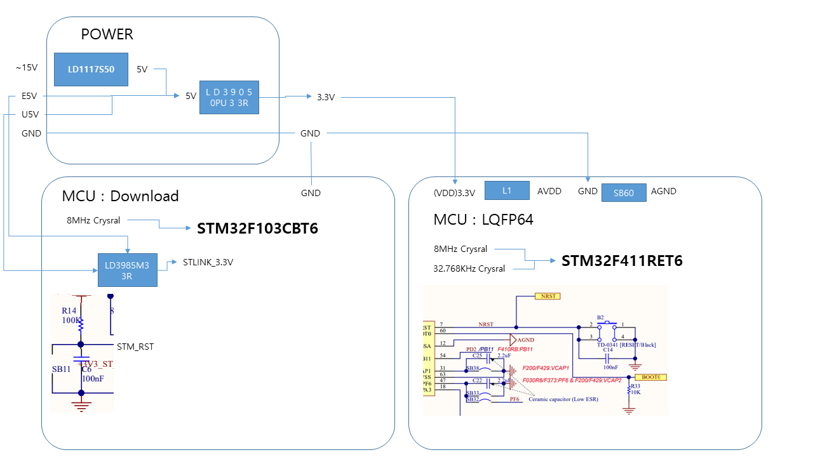
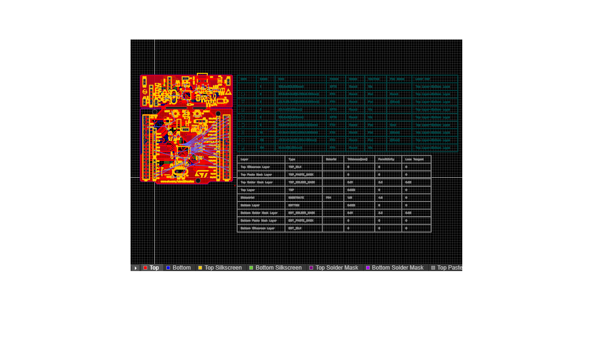
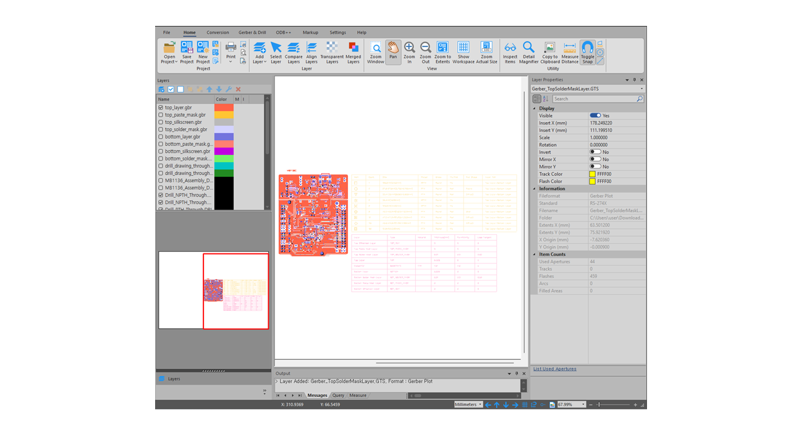
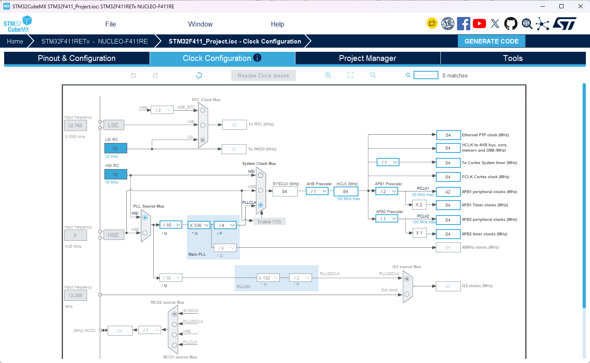
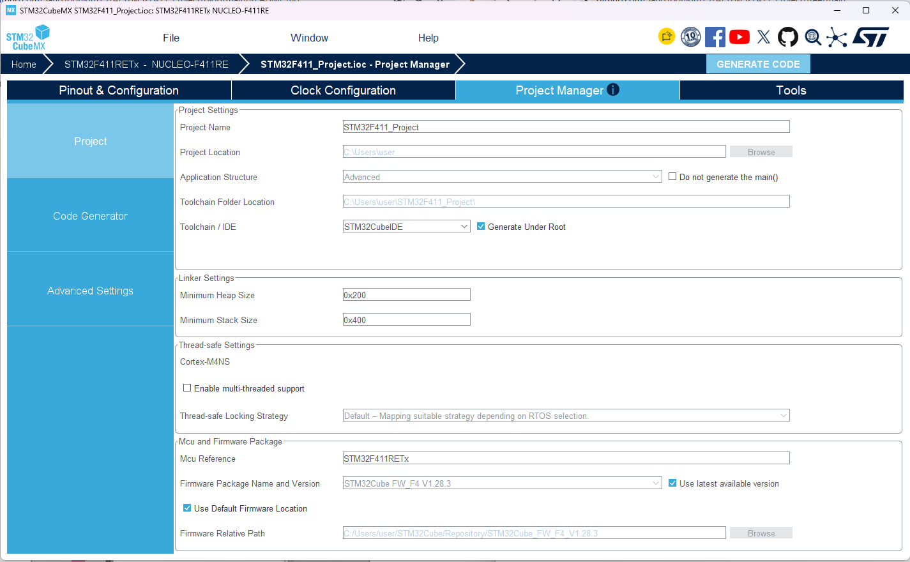

# STM32F411_Project

## Hardware
<br> "블록도"

<br> "회로도"

<br> "거버파일"

<br> "3D배치"

### STM32F411MX
#### RCC 설정
-
<br> "RCC"

#### Clock 설정 
-
<br> "Clock"

#### STM32F411IDE 설정
-
<br> "STM32F411IDE"

# H1 제목
## H2 제목  
### H3 제목
#### H4 제목
##### H5 제목
###### H6 제목

*이탤릭체* 또는 _이탤릭체_

**볼드체** 또는 __볼드체__

***볼드 이탤릭*** 또는 ___볼드 이탤릭___

~~취소선~~

`인라인 코드`

- 항목 1
- 항목 2
  - 하위 항목 1
  - 하위 항목 2
    - 더 깊은 하위 항목

1. 첫 번째 항목
2. 두 번째 항목
   1. 하위 항목 1
   2. 하위 항목 2
3. 세 번째 항목

[NAVER](https://www.naver.com)

http://www.naver.com

`console.log('Hello World')`

```javascript
function hello() {
    console.log('Hello World');
}
```
```python
def hello():
    print("Hello World")
```
```bash
npm install package-name
```
```
def hello():
    print("Hello World")
```
| 열1 | 열2 | 열3 |
|:-----|:-----:|-----:|
| 데이터1 | 데이터2 | 데이터3 |
| 데이터4 | 데이터5 | 데이터6 |

이것은 인용문입니다.
> 여러 줄의 인용문도 가능합니다.
>
> > 중첩된 인용문
---

#Chapter1
---

#Chapter2

# STM32F411_Project

## Hardware
---
<br> "블록도"
<br> "QR코드"

## Software
---

<p align="center">
  
</p>

<p align="center">
  
</p>

<p align="center">
  
</p>

<p align="center">
  
</p>

<p align="center">
  
</p>

