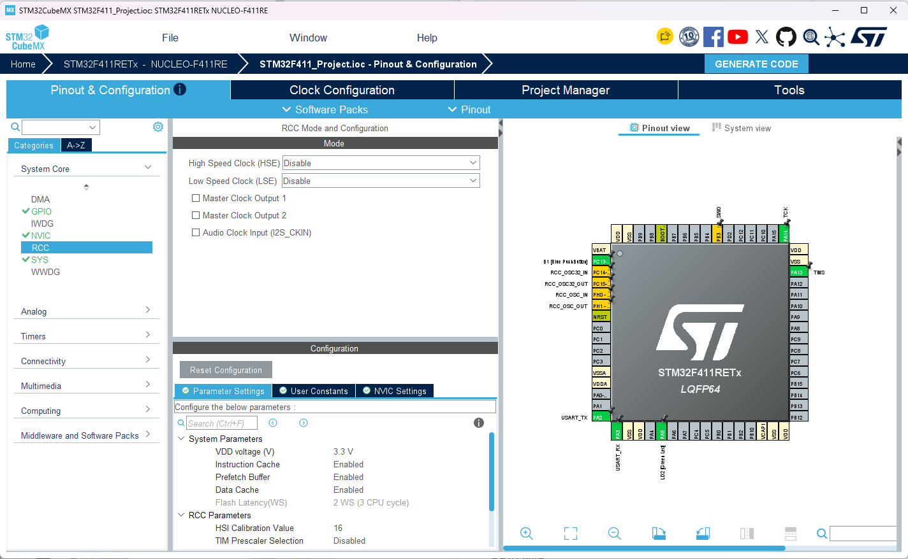
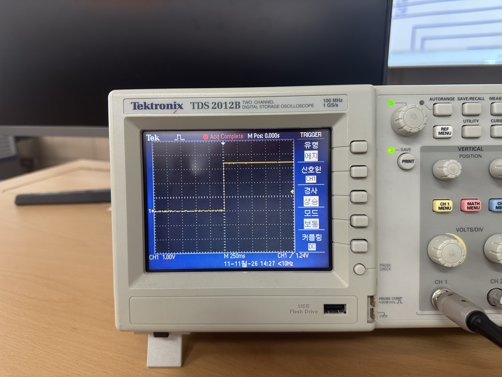
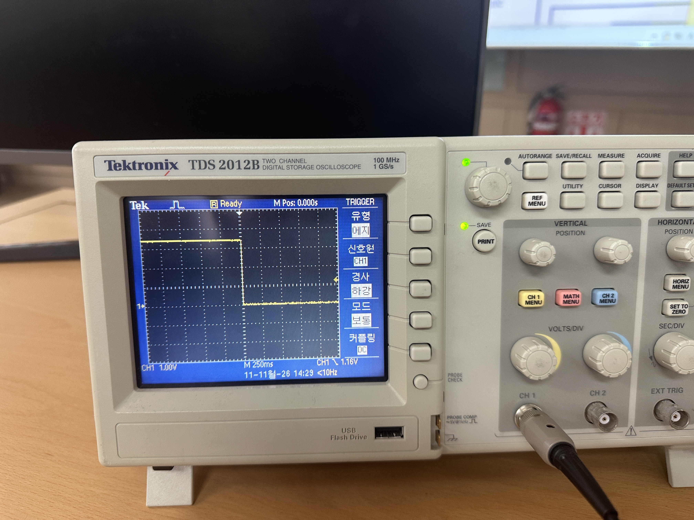

# STM32F411_Project

## Hardware
#### - 블록도
<br> "블록도"

#### - 회로도
<br> "회로도"

#### - 거버파일
<br> "거버파일"

#### - 3D배치
<br> "3D배치"

### STM32F411MX
#### - RCC 설정
<br>

#### - Clock 설정 
<br>

#### - STM32F411IDE 설정
<br>

---

# GPIO

## Table of Contents
- [1. Architecture](./docs/F411_Architecture.md)
- [2. MemoryMap](./docs/F411_MemoryMap.md)
- [3. GPIO](../docs/F411_Gpio.md)

## Software
---

## Table of Contents
- [1. Test](./docs/F411_Test.md)
   
### GPIOA 포트에서 PIN6으로 설정하여 테스트 하기

#### 1.	Add Watch Expression 을 통해서 "GPIOA"을 추가한다.
```
	설정값을 변경하여 테스트를 진행하도록 합니다.
    조건 : 소스코드
	  HAL_GPIO_WritePin(GPIOA, GPIO_PIN_6, 1);
	  HAL_Delay(1000);
	  HAL_GPIO_WritePin(GPIOA, GPIO_PIN_6, 0);
	  HAL_Delay(1000);
	으로 변경한 이후

    Add Watch Expression 을 통해서
    Expression             ...           Value      
       GPIOA
          MODER                         0xa80010a0
                          ...
          ODR             ...           40 [LED On 조건], 0 [LED off 조건] 
                          ...          
```
#### 오실로스코프 결과 보기
| **LED On 결과** | **LED Off 결과** |
| :---: | :---: |
|  |  |


