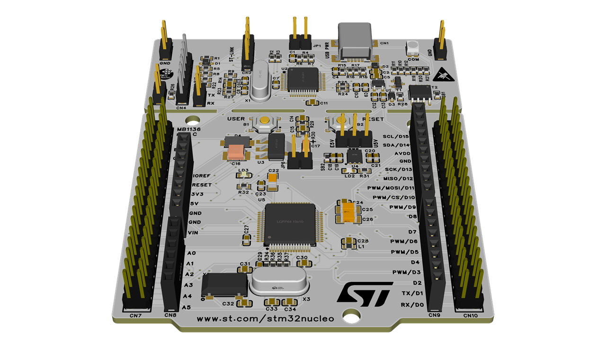

# STM32F411_Project

## Hardware
#### - 블록도
  "블록도"

#### - 회로도
  "회로도"

#### - 거버파일
  "거버파일"

#### - 3D배치
  "3D배치"

### STM32F411MX
#### - RCC 설정
 

#### - Clock 설정 
 

#### - STM32F411IDE 설정
 

# STM32F411_Project

## Hardware
---
  "블록도"
  "QR코드"

## Software
---

