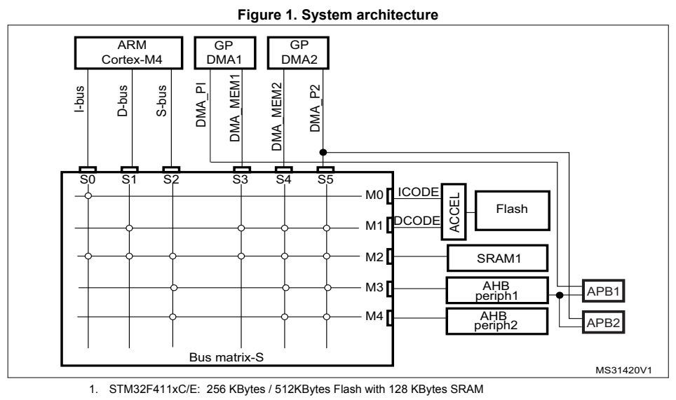
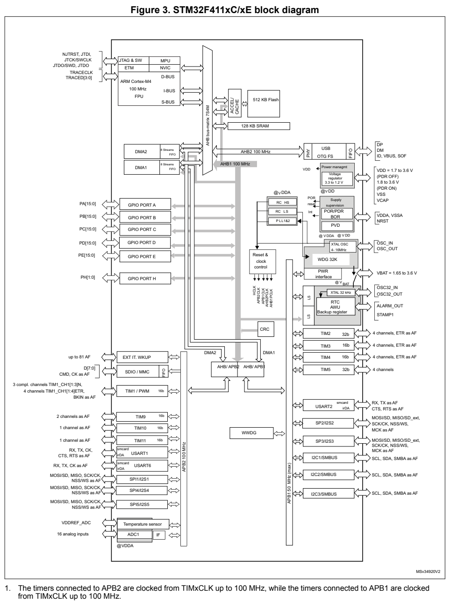

## 1. Architecture
	
#### 메모리 및 버스 아키텍처

##### 시스템 아키텍처

* STM32F411xC/E의 메인 시스템은 32비트 다중 계층(multilayer) AHB 버스 매트릭스로 구성되어 있으며, 이를 통해 다음 요소들이 상호 연결됩니다.  
* 6개의 마스터(Master):
   * FPU를 포함한 Cortex-M4 코어의 I-버스(I-bus), D-버스(D-bus) 및 S-버스(S-bus)
   * DMA1 메모리 버스
   * DMA2 메모리 버스
   * DMA2 주변장치(peripheral) 버스
* 5개의 슬레이브(Slave):
   * 내부 플래시 메모리 ICode 버스
   * 내부 플래시 메모리 DCode 버스
   * 메인 내부 SRAM
   * AHB-APB 브리지 및 APB 주변장치를 포함한 AHB1 주변장치
   * AHB2 주변장치

버스 매트릭스는 마스터가 슬레이브에 접근할 수 있도록 경로를 제공하며, 여러 고속 주변장치가 동시에 작동할 때에도 동시 접근을 가능하게 하여 효율적인 동작을 지원합니다. 이러한 아키텍처는 그림 1에 나타나 있습니다.

  

#### 2.1.1 I-bus(명령 버스)
이 버스는 FPU가 포함된 Cortex®-M4 코어의 명령 버스(Instruction bus)를 BusMatrix에 연결합니다. 코어는 이 버스를 사용하여 명령을 가져옵니다(fetch). 이 버스의 대상은 코드가 저장된 메모리(내부 플래시 메모리/SRAM)입니다.	

#### 2.1.2 D-bus(데이터 버스)
이 버스는 FPU가 포함된 Cortex®-M4의 데이터 버스를 BusMatrix에 연결합니다. 코어는 이 버스를 사용하여 리터럴(상수) 값을 로드하거나 디버깅을 위한 접근을 수행합니다. 이 버스의 대상은 코드나 데이터가 저장된 메모리(내부 플래시 메모리/SRAM)입니다.

#### 2.1.3 S-bus(시스템 버스)
이 버스는 FPU가 포함된 Cortex®-M4 코어의 시스템 버스를 BusMatrix에 연결합니다. 이 버스는 주변 장치(peripheral)나 SRAM에 위치한 데이터에 접근하는 데 사용됩니다. 명령을 가져오는(fetch) 용도로도 사용할 수 있지만, ICode 버스를 사용하는 것보다 효율성은 떨어집니다. 이 버스의 대상은 내부 SRAM1, AHB1 주변 장치(APB 주변 장치 포함), 그리고 AHB2 주변 장치입니다.

#### 2.1.4 DMA 메모리 버스
이 버스는 DMA 메모리 버스 마스터 인터페이스를 BusMatrix에 연결합니다. DMA가 메모리와 데이터를 주고받는(전송하는) 작업을 수행할 때 사용됩니다. 이 버스의 대상은 데이터 메모리(내부 플래시 메모리, 내부 SRAM)이며, S4의 경우 AHB1/AHB2 주변 장치(APB 주변 장치 포함)도 대상에 포함됩니다.

#### 2.1.5 DMA 주변 장치 버스
이 버스는 DMA 주변 장치 마스터 버스 인터페이스를 BusMatrix에 연결합니다. DMA가 AHB 주변 장치에 접근하거나 메모리 간(memory-to-memory) 데이터 전송을 수행할 때 사용됩니다. 이 버스의 대상은 AHB 및 APB 주변 장치와 데이터 메모리(플래시 메모리 및 내부 SRAM)입니다.

#### 2.1.6 BusMatrix(버스 매트릭스)
BusMatrix는 마스터 간의 접근 중재(arbitration)를 관리합니다. 중재 방식으로는 라운드 로빈(round-robin) 알고리즘이 사용됩니다. 

#### 2.1.7 AHB/APB 브리지(APB)
두 개의 AHB/APB 브리지인 APB1과 APB2는 AHB 버스와 두 개의 APB 버스 간에 완전 동기식 연결을 제공하며, 이를 통해 주변 장치(peripheral)의 동작 주파수를 유연하게 선택할 수 있습니다.
APB1 및 APB2의 최대 동작 주파수에 대한 자세한 내용은 해당 디바이스의 데이터시트를 참조하고, AHB 및 APB 주변 장치의 주소 매핑에 대해서는 표 1을 참조하십시오.
디바이스가 리셋될 때마다 모든 주변 장치 클록은 비활성화됩니다(SRAM 및 플래시 메모리 인터페이스는 예외). 주변 장치를 사용하려면 먼저 RCC_AHBxENR 또는 RCC_APBxENR 레지스터를 통해 해당 주변 장치의 클록을 활성화해야 합니다.

참고: APB 레지스터에 대해 16비트 또는 8비트 액세스를 수행하면, 해당 액세스는 32비트 액세스로 변환됩니다. 즉, 브리지가 16비트 또는 8비트 데이터를 복제하여 32비트 벡터를 구성합니다.
   
  
