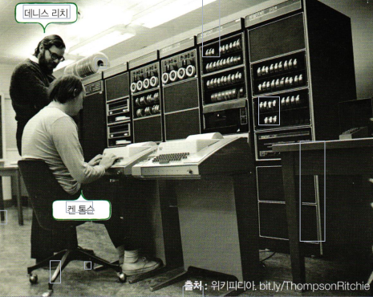
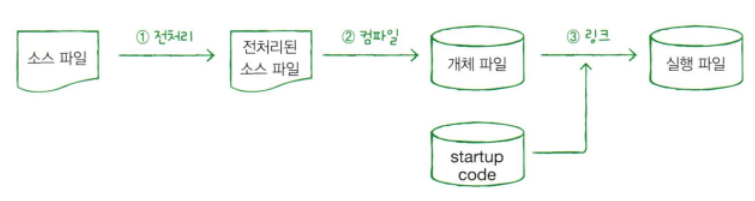
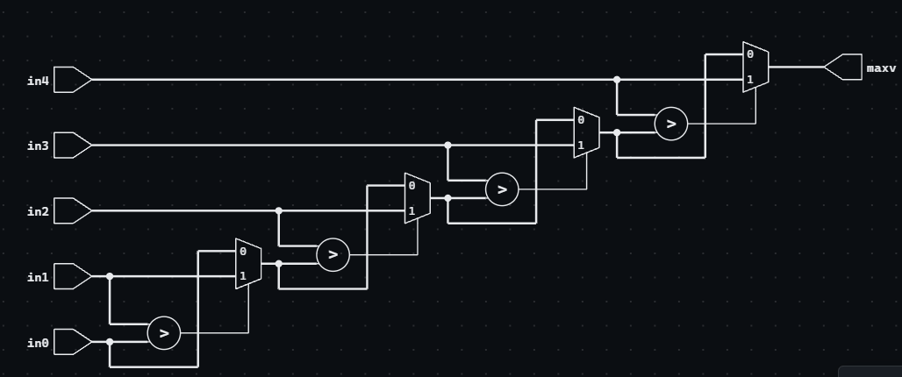
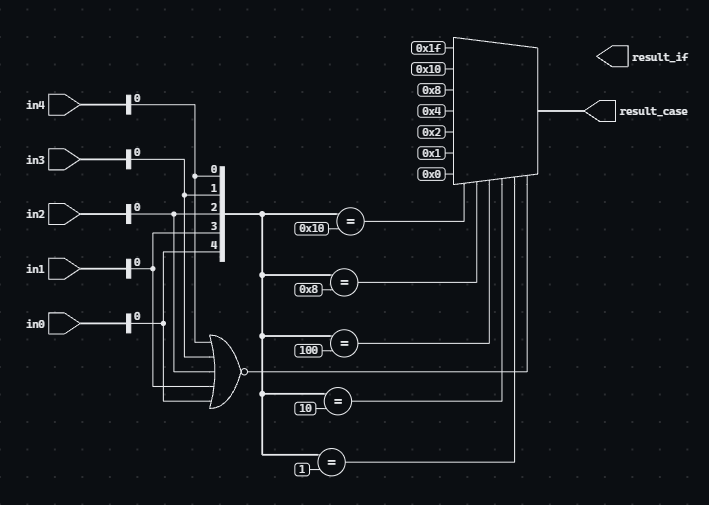

## Hardware

### 1.1 C 언어의 탄생

C언어는 1972년, 유닉스 시스템에 사용하기 위해 켄 톰슨이 만든 B언어를 데니스 리치가 발전시켜 만든 언어입니다. 1969년에 개발된 초기 유닉스는 대부분 어셈블리어로 작성되어 컴퓨터의 하드웨어가 바뀌며 유닉스를 다시 개발해야 하는 문제가 있었습니다. 이런 불편을 해결하고자 데니스 리치는 하드웨어에 상관없이 사용할 수 있는 C언어를 만들었습니다.

 <br>

### 1.2 C 언어의 장점

**1.시스템 프로그래밍이 가능합니다.**
  - 운영체제를 개발할 목적으로 만든 언어이므로 이를 사용해 하드웨어를 제어하는 시스템으로 프로그래밍이
    가능합니다.

**2.이식성을 갖춘 프로그램을 만들 수 있습니다.**
  - 이식성이란, 기종이 다른 컴퓨터에서도 올바르게 작동하는 성질을 의미합니다. 즉, 표준을 지켜 프로그램
    을 만들면 이식성을 갖추게 되어 컴퓨터의 종류가 바뀌더라도 그 프로그램을 계속해서 활용할 수 있습니
    다. 표준에 정의되지 않은 문법을 사용한 프로그램은 특정 컴파일러에서만 컴파일될 가능성이 있어 이식
    성이 떨어집니다.

**3.함수를 사용해 개별 프로그래밍이 가능합니다.**
  - 무엇보다 함수를 사용해 기능별로 프로그래밍할 수 있으므로 개발 과정에서 에러를 수정하기 쉽고 개발된
    후에도 프로그램의 유지보수에 도움이 됩니다. 물론 잘 만들어진 함수는 새로운 프로그램의 개발에 재활
    용할 수 있습니다.

### 1.3 컴파일 과정 3단계

 <br>

**1.3.1 전처리**
   - 전처리 과정은 전처리 지시자에 따라 소스 파일을 가공하는 과정
   - 주로 소스 파일을 컴퓨터에 맞게 편집하는 일이므로 전처리를 수행해도 파일의 형태는 달라지지 않습니다.
**1.3.2 컴파일**
   - 전처리가 끝난 파일을 컴파일하면 개체 파일이 됩니다.
   - 개체 파일은 CPU가 해석할 수 있는 명령어들로 이루어진 기계어 파일이지만, **바로 실행하는 것은 불가능합니다.**
   - 프로그램은 운영체제에 의해서 실행되므로 개체 파일을 설치된 운영체제가 인식할 수 있는 형태의 실행 파일로 바꿔야 합니다.
**1.3.3 링크**
   - 개체 파일에 startup code를 결합하는 과정을 수행하는데 이 과정을 링크라고 합니다.
   - startup code는 프로그램을 실행하기 전에 필요한 준비 작업을 수행하며 main함수를 호출해 우리가 작성한 프로그램의 코드가
     실행되도록 합니다.
     
### 1.4 타입별 출력 내용 정리

① 정수형 출력

| 서식 지정자| 의미 | 예시 |
| :---: | :---: | :---: |
| %d  | 10진수 부호 있는 정수  | 123 |
| %i  | 10진수 부호 있는 정수  | 123 |
| %u  | 부호 없는 10진수 정수  | 123 |
| %o  | 8진수 정수  | 17  |
| %x  | 16진수 정수 (소문자)  | ff |
| %X  | 16진수 정수 (대문자)  | FF |

② 실수형 출력
| 서식 지정자| 의미 | 예시 |
| :---: | :---: | :---: |
| %f  | 소수점 형식으로 출력  | 3.400000 |
| %lf  | printf()에서는 %f와 동일  | 3.400000 |
| %e  | 지수 형식 (소문자)  | 3.400000e+00 |
| %E  | 지수 형식 (대문자)  | 3.400000E+00  |
| %g  | %f 또는 %e 중 적절한 형식 선택  | 3.4 |
| %G  | %g와 유사하지만 지수에 대문자 사용  | 3.4 |

③ 문자 및 문자열 출력

| 서식 지정자| 의미 | 예시 |
| :---: | :---: | :---: |
| %c  | 문자 출력  | A |
| %s  |문자열 출력  | Hello |
| %p  | 포인터 주소 출력  | 0x... |

④ 기타 서식 지정자
| 서식 지정자| 의미 |
| :---: | :---: |
| %%  | % 문자 자체를 출력  |
| %ld  | long 정수 출력  |
| %lld  | long long 정수 출력  | 
| %hd  | short 정수 출력  | 
| %zu  | size_t 자료형 출력  | 


#### 소수점 자릿수 지정하기

| 서식 지정자| 의미 | 예시 |
| :---: | :---: | :---: |
| %f  | 소수점 이하 6자리  | 3.400000 |
| %.1f  | 소수점 이하 1자리  | 3.4|
| %.2f  | 소수점 이하 2자리  | 3.40 |
| %.3f  | 소수점 이하 3자리 | 3.400  |
| %.5f  | 소수점 이하 5자리  | 3.40000 |
| %.10f  | 소수점 이하 10자리  | 3.4000000000 |

PC와 STM32F411 자료형 크기 비교
단위: Byte (1 Byte = 8 bit), 일반적인 ABI 기준

| 자료형 | Windows PC (64bit) | Linux PC (64bit) |  STM32F411 (32bit) |
| :---: | :---: | :---: |  :---: |
| char  | 1  | 1  | 1  |
| short  | 2  |  2  | 2  |
| int  |  4  |  4  |  4  |
| long  |  4  |  4  |  4  |
| long long  |  8  |  8  |  8  |
| float | 4  | 4  |  4  |
| double | 8  |  8  |  8  |
| long double |  8  |  16  |  보통 8 또는 컴파일러 의존   |
| 포인터 * |  8  |  8  |  4  |


## Software

```c
#define _CRT_SECURE_NO_WARNINGS
#include <stdio.h>

int main(void)
{

    int age;
    double height;

    printf("Please input your age and height:");
    scanf_s("%d%lf", &age, &height);
    printf("Your age :%d and height:%.1lfcm", age,height);

    return 0;

}

```c
#include <stdio.h>
#include <windows.h>

#define HIGH 1
#define LOW 0

long unsigned int echo(void)
{
    long unsigned int echo_val = 0;
    unsigned char HAL_GPIO_ReadPin = 0;
    unsigned int TIM_COUNTER = 0;

    while (HAL_GPIO_ReadPin == LOW) {}   /* 1) 상승(HIGH) 대기 */
    TIM_COUNTER = 0;                        /* 2) 카운터 0 */
    while (HAL_GPIO_ReadPin == HIGH) {    /* 3) 하강(LOW)까지 카운트 */
        TIM_COUNTER++;
    }
    echo_val = TIM_COUNTER;                 /* 4) HIGH 유지 시간(us) */

    if (echo_val >= 240 && echo_val <= 23000) return echo_val;
    return 0;
}
int main(void)
{
    while (1)
    {
        echo();    
    //    Sleep(1000);
    }

}
```

```c

#include <stdio.h>

int main(void)
{
    int a, b;
    int sum, sub, mul, inv;

    a = 10;
    b = 20;
    sum = a + b;
    sub = a - b;
    mul = a * b;
    inv = -a;

    printf("a :%d, b=%d\n", a, b);
    printf("sum :%d\n", sum);
    printf("sub :%d\n", sub);
    printf("mul :%d\n", mul);
    printf("inv :%d\n", inv);

    return 0;
}
```

```c

module calc (
    input  signed [31:0] a,
    input  signed [31:0] b,
    output signed [31:0] sum,
    output signed [31:0] sub,
    output signed [31:0] mul,
    output signed [31:0] inv
);
    assign sum = a + b;
    assign sub = a - b;
    assign mul = a * b;   // 32비트 연산 (C int와 동일, 넘치면 wrap)
    assign inv = -a;
endmodule
```

```c

module five_input_logic (
    input  wire [3:0] in0,
    input  wire [3:0] in1,
    input  wire [3:0] in2,
    input  wire [3:0] in3,
    input  wire [3:0] in4,
    output reg  [3:0] maxv
);
    integer i;
    reg [3:0] in_arr [0:4];

    always @(*) begin
        in_arr[0] = in0;
        in_arr[1] = in1;
        in_arr[2] = in2;
        in_arr[3] = in3;
        in_arr[4] = in4;

        maxv = in_arr[0];
        for (i = 1; i < 5; i = i + 1) begin
            if (in_arr[i] > maxv)
                maxv = in_arr[i];
        end
    end
endmodule

====================================
IF Resources
====================================
Other : Greater Than 4 / Multiplexer 4
I/O Ports : Inputs 5 / Outputs 1
Total : Cells 8 / Total Wires 19
Comb. Depth 8

====================================
SWITCH CASE Resources
====================================
Logic Gates : NOT 1
Other : Equality 5 / Multiplexer : 1
I/O Ports : Inputs 5 / Outputs 2
Total Cells 7 / Total Wires13
Comb. Depth2

 <br>
```

```C
module five_input_logic (
    input  wire [3:0] in0,
    input  wire [3:0] in1,
    input  wire [3:0] in2,
    input  wire [3:0] in3,
    input  wire [3:0] in4,
    output reg  [4:0] result_if,
    output reg  [4:0] result_case
);

    // ---- case 문 사용 (5개 입력 조합 디코딩) ----
    always @(*) begin
        case ({in0[0], in1[0], in2[0], in3[0], in4[0]})
            5'b00000: result_case = 5'd0;
            5'b00001: result_case = 5'd1;
            5'b00010: result_case = 5'd2;
            5'b00100: result_case = 5'd4;
            5'b01000: result_case = 5'd8;
            5'b10000: result_case = 5'd16;
            default : result_case = 5'd31; // 그 외 조합
        endcase
    end

endmodule

 <br>
```
##### 라이징 에지 검출 / 폴링 에지 검출 코드를 c 로 작성하시오.

###### for문
```c
#include <stdio.h>
#include <windows.h>

#define HIGH 1
#define LOW 0

int main(void)
{
// 테스트를 위한 임의의 신호 흐름 (0 -> 0 -> 1 -> 1 -> 1 -> 0 -> 0)
int signal[] = { LOW, LOW, HIGH, HIGH, HIGH, LOW, LOW };
int length = sizeof(signal) / sizeof(signal[0]);

int prev_state = LOW; // 이전 신호 상태 (초기값 LOW)
int curr_state = LOW; // 현재 신호 상태

for (int i = 0; i < length; i++) {
curr_state = signal[i]; // 새로운 신호 입력

// Rising Edge condition : LOW -> HIGH
if (prev_state == LOW && curr_state == HIGH) {
printf("[%d] Rising Edge !\n", i);
}
// Falling Edge condition : HIGH -> LOW
else if (prev_state == HIGH && curr_state == LOW) {
printf("[%d] Falling Edge !\n", i);
}
// 상태 변화가 없을 때 (LOW -> LOW 또는 HIGH -> HIGH)
else {
printf("[%d] Echo Time !\n", i);
}

// 다음 검사를 위해 현재 상태를 이전 상태로 저장
prev_state = curr_state;

Sleep(500); // 0.5초 대기
}

return 0;
}

```

###### while 문
```c
#include <stdio.h>
#include <windows.h>

#define HIGH 1
#define LOW 0

//가상의 핀 입력 함수
int read_pin(int step) {
	int pulse_signal[] = {LOW, LOW, HIGH, HIGH, HIGH, LOW, LOW};
	return pulse_signal[step];
}

int main(void)
{
	int step = 0;
	int prev_state = LOW;
	int curr_state = LOW;
	
	// 1. Rising Edge 검출(LOW -> HIGH)
	// 현재 상태가 LOW인 동안은 계속 대기(Echo Time)하며 루프 반복
	while(curr_state == LOW) {
		printf("Echo Time! (LOW status) \n");
		Sleep(300);
		
		prev_state = curr_state;
		curr_state = read_pin(step++); /새로운 신호 읽기
	}
	
	// while 문을 빠져나왔다는 것은 curr_state가 HIGH로 변했다는 의미
	if(prev_state == LOW && curr_state == HIGH) {
		printf("Rising Edge! (LOW -> HIGH)\n");
	}
	
	// 2. Falling Edge 검출 ( HIGH -> LOW)
	// 현재 상태가 HIGH인 동안은 계속 대기(Echo Time)하며 루브 반복
	while(curr_state == HIGH) {
		printf("Echo Time! (HIGH pulse status)\n");
		Sleep(300);
		
		prev_state = curr_state;
		curr_state = read_pin(step++); // 새로운 신호 읽기
	}
	
	//while문을 빠져나왔다는 것은 curr_state가 LOW로 변했다는 의미
	if(prev_state == HIGH && curr_state == LOW) {
		printf("Falling Edge! (HIGH -> LOW)\n");
	}
	
	return 0;
	
}

```

[⬅️ 메인 README.md로 돌아가기](../README.md)
