## 3. GPIO
   
## 8 범용 입출력(GPIO)
STM32F411xC/E 모델에서는 GPIO F/G/H/I/J/K를 사용할 수 없습니다(GPIOH0 및 GPIOH1은 제외).

### 8.1 GPIO 개요

각 범용 입출력(GPIO) 포트에는 4개의 32비트 설정 레지스터(GPIOx_MODER, GPIOx_OTYPER, GPIOx_OSPEEDR, GPIOx_PUPDR),  
2개의 32비트 데이터 레지스터(GPIOx_IDR, GPIOx_ODR),   
32비트 세트/리셋 레지스터(GPIOx_BSRR),   
32비트 잠금 레지스터(GPIOx_LCKR),   
그리고 2개의 32비트 대체 기능 선택 레지스터(GPIOx_AFRH, GPIOx_AFRL)가 포함되어 있습니다. 

### 8.2 GPIO 주요 특징

   * 최대 16개의 I/O 제어 가능
   * 출력 상태: 푸시-풀(push-pull) 또는 오픈-드레인(open-drain) + 풀업/풀다운(pull-up/down)
   * 출력 데이터 소스: 출력 데이터 레지스터(GPIOx_ODR) 또는 주변 장치(대체 기능 출력)
   * 각 I/O별 속도 설정 가능
   * 입력 상태: 플로팅(floating), 풀업/풀다운, 아날로그
   * 입력 데이터 목적지: 입력 데이터 레지스터(GPIOx_IDR) 또는 주변 장치(대체 기능 입력)
   * 비트 설정 및 리셋 레지스터(GPIOx_BSRR)를 통한 GPIOx_ODR의 비트 단위 쓰기 접근 지원
   * I/O 구성을 고정할 수 있는 잠금 메커니즘(GPIOx_LCKR) 제공
   * 아날로그 기능 지원
   * 대체 기능(Alternate Function, AF) 입출력 선택 레지스터 (I/O당 최대 16개의 AF 지원)
   * 2클럭 주기마다 상태를 변경할 수 있는 고속 토글(fast toggle) 기능
   * 유연한 핀 멀티플렉싱을 통해 I/O 핀을 범용 I/O(GPIO) 또는 다양한 주변 장치 기능으로 활용 가능

### 8.3 GPIO 기능 설명

데이터시트에 명시된 각 I/O 포트의 하드웨어 특성에 따라, 범용 I/O(GPIO) 포트의 각 비트는 소프트웨어를 통해 다음과 같은 여러 모드로 개별 설정할 수 있습니다.
   * 입력 플로팅(Input floating)
   * 입력 풀업(Input pull-up)
   * 입력 풀다운(Input pull-down)
   * 아날로그(Analog)
   * 오픈-드레인 출력 (풀업 또는 풀다운 기능 포함)
   * 푸시-풀 출력 (풀업 또는 풀다운 기능 포함)
   * 대체 기능 푸시-풀 출력 (풀업 또는 풀다운 기능 포함)
   * 대체 기능 오픈-드레인 출력 (풀업 또는 풀다운 기능 포함)

각 I/O 포트 비트는 자유롭게 프로그래밍할 수 있지만, I/O 포트 레지스터에 접근할 때는 32비트 워드, 하프 워드 또는 바이트 단위로 접근해야 합니다. GPIOx_BSRR 레지스터는 GPIO 레지스터에 대한 원자적(atomic) 읽기/수정 접근을 가능하게 합니다. 이를 통해 읽기 작업과 수정 작업 사이에 인터럽트(IRQ)가 발생할 위험을 방지할 수 있습니다. 5V 허용(5V-tolerant) I/O 포트 비트의 기본 구조를 보여줍니다. 표 26은 포트 비트의 가능한 구성들을 나타냅니다.

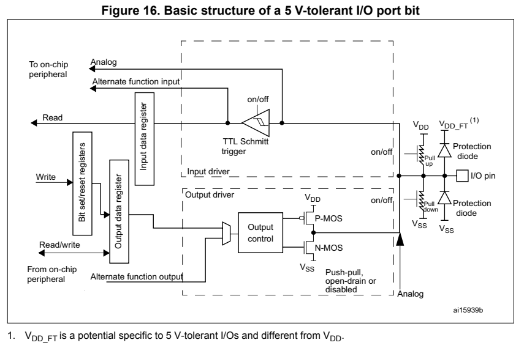  

#### 8.3.9 입력 구성

I/O 포트가 입력으로 설정된 경우:
   * 출력 버퍼가 비활성화됩니다.
   * 슈미트 트리거(Schmitt trigger) 입력이 활성화됩니다.
   * GPIOx_PUPDR 레지스터의 값에 따라 풀업(pull-up) 및 풀다운(pull-down) 저항이 활성화됩니다.
   * I/O 핀에 존재하는 데이터는 매 AHB 클록 주기마다 입력 데이터 레지스터로 샘플링됩니다.
   * 입력 데이터 레지스터를 읽으면 I/O 상태를 확인할 수 있습니다. 그림 18은 I/O 포트 비트의 입력 구성을 보여줍니다.

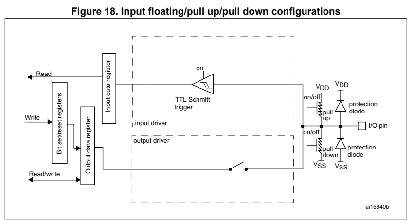  

#### 8.3.10 출력 구성
I/O 포트가 출력으로 설정된 경우:
   * 출력 버퍼가 활성화됩니다.

오픈 드레인(Open-drain) 모드: 출력 레지스터의 값이 '0'이면 N-MOS가 활성화되고, '1'이면 포트가 하이 임피던스(Hi-Z) 상태가 됩니다(P-MOS는 절대 활성화되지 않음). 푸시-풀(Push-pull) 모드: 출력 레지스터의 값이 '0'이면 N-MOS가 활성화되고, '1'이면 P-MOS가 활성화됩니다.

   * 슈미트 트리거(Schmitt trigger) 입력이 활성화됩니다.
   * 약한(weak) 풀업 및 풀다운 저항은 GPIOx_PUPDR 레지스터의 설정값에 따라 활성화 여부가 결정됩니다.
   * I/O 핀에 존재하는 데이터는 매 AHB 클록 주기마다 입력 데이터 레지스터로 샘플링됩니다.
   * 입력 데이터 레지스터를 읽으면 현재 I/O 상태를 확인할 수 있습니다.
   * 출력 데이터 레지스터를 읽으면 마지막으로 기록된 값을 확인할 수 있습니다. 그림 19는 I/O 포트 비트의 출력 구성을 보여줍니다.

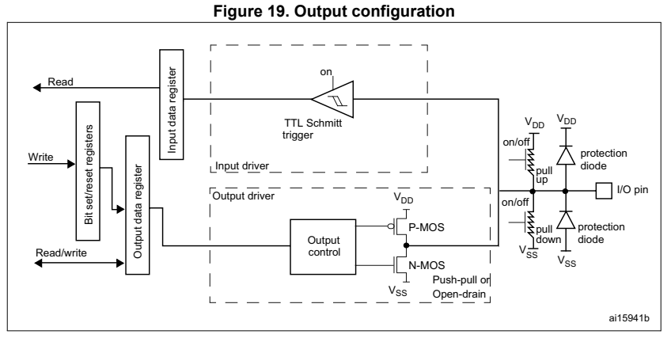  

#### 8.3.11 대체 기능(Alternate function) 구성
I/O 포트가 대체 기능으로 설정된 경우:
   * 출력 버퍼는 오픈 드레인(open-drain) 또는 푸시-풀(push-pull) 방식으로 구성할 수 있습니다.
   * 출력 버퍼는 주변 장치(peripheral)에서 오는 신호(송신기 활성화 및 데이터)에 의해 구동됩니다.
   * 슈미트 트리거(Schmitt trigger) 입력이 활성화됩니다.
   * 약한(weak) 풀업 및 풀다운 저항은 GPIOx_PUPDR 레지스터의 설정값에 따라 활성화 여부가 결정됩니다.
   * I/O 핀에 존재하는 데이터는 매 AHB 클록 주기마다 입력 데이터 레지스터로 샘플링됩니다.
   * 입력 데이터 레지스터를 읽으면 현재 I/O 상태를 확인할 수 있습니다.

그림 20은 I/O 포트 비트의 대체 기능 구성을 보여줍니다.

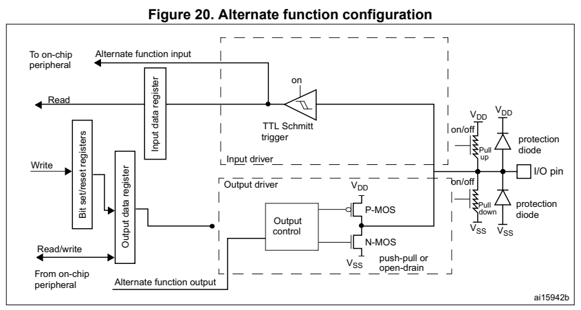  

#### 8.3.12 아날로그 구성

I/O 포트가 아날로그 구성으로 설정된 경우:
   * 출력 버퍼가 비활성화됩니다.

참고:
   * 슈미트 트리거(Schmitt trigger) 입력이 비활성화되어, I/O 핀의 아날로그 값에 관계없이 전력 소비가 발생하지 않습니다. 슈미트 트리거의 출력은 고정된 값(0)으로 강제 설정됩니다.
   * 약한(weak) 풀업 및 풀다운 저항이 비활성화됩니다.
   * 입력 데이터 레지스터를 읽으면 값 "0"이 반환됩니다.
아날로그 구성 상태인 I/O 핀은 5V 내성(5V tolerant)을 가질 수 없습니다.
그림 21은 I/O 포트 비트의 고임피던스 아날로그 입력 구성을 보여줍니다.

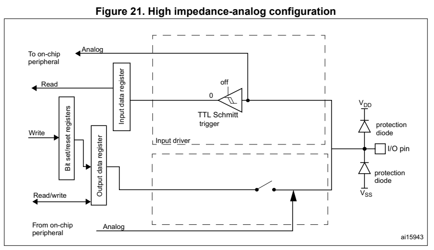  

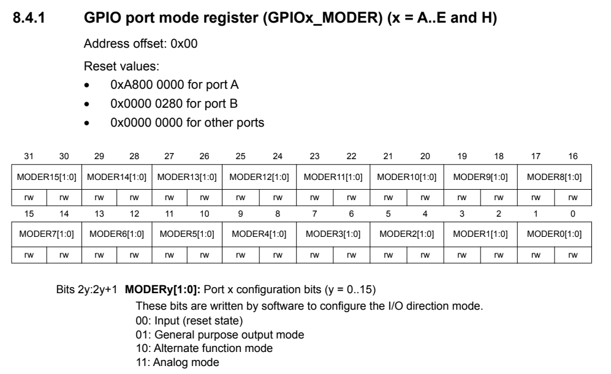  
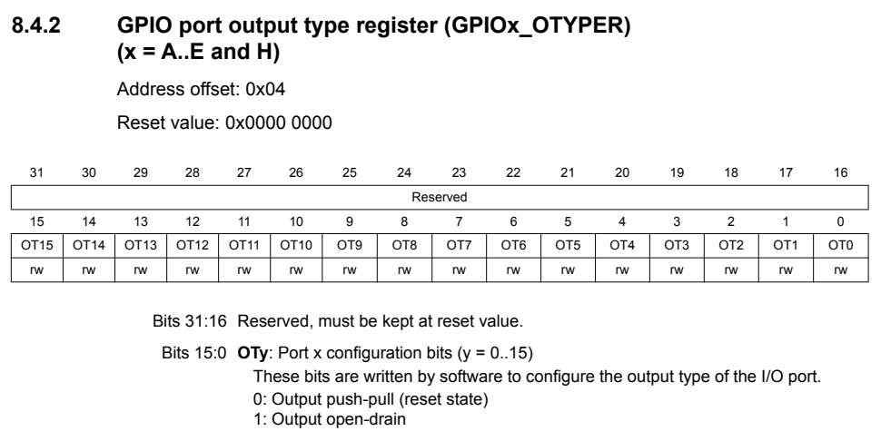  
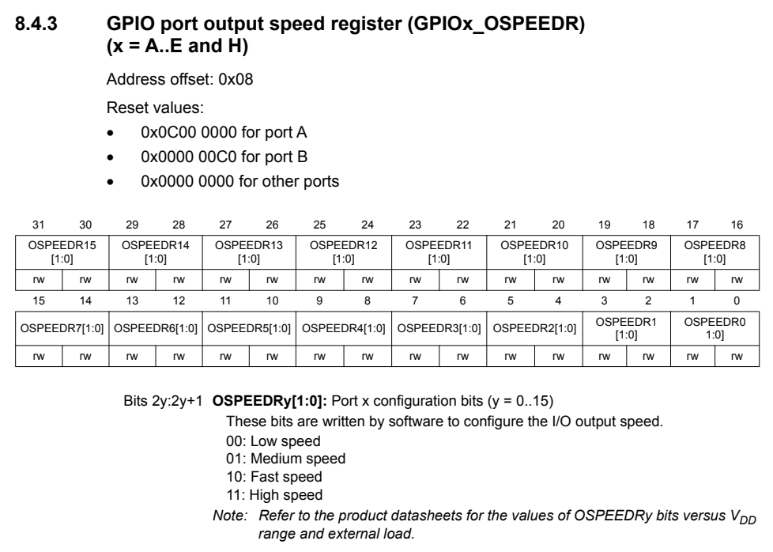  
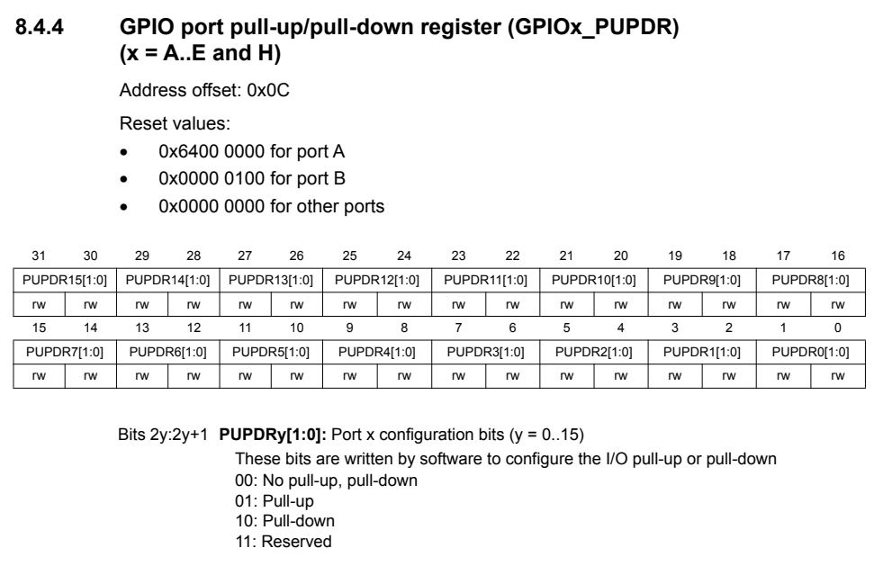  
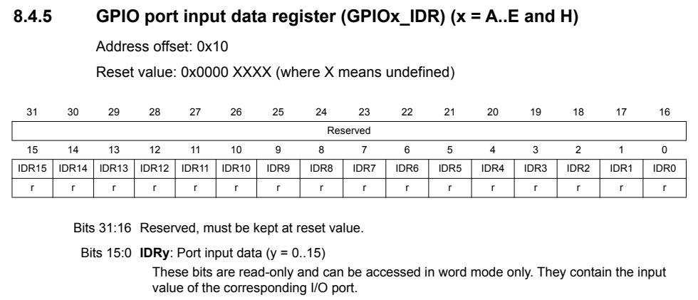  
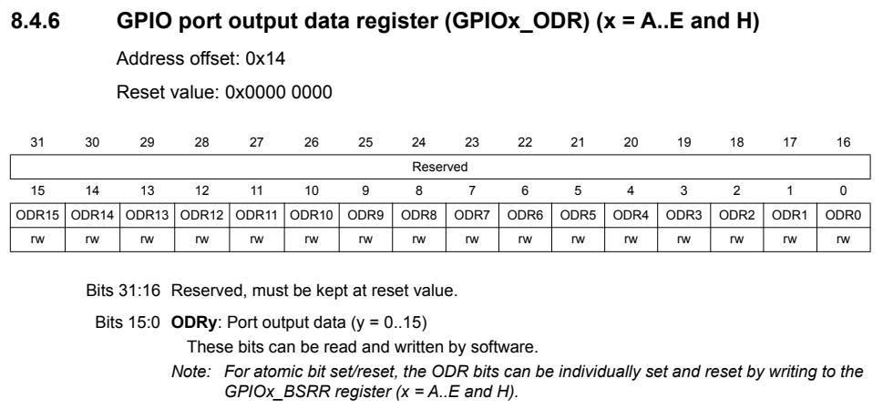  
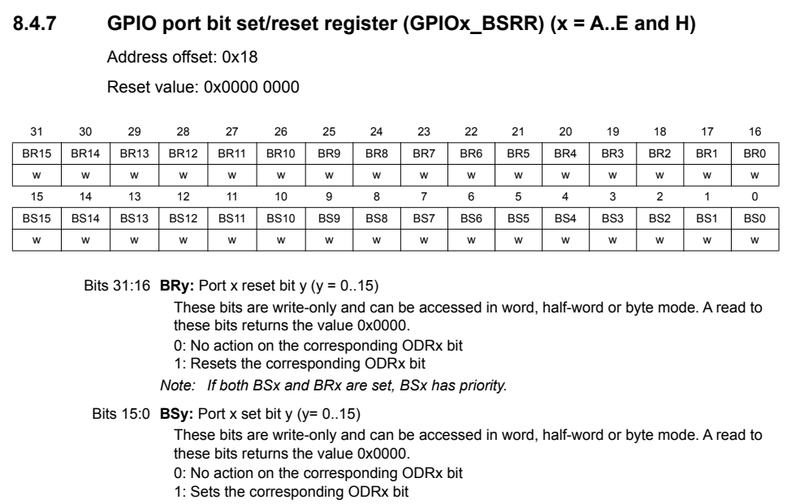  
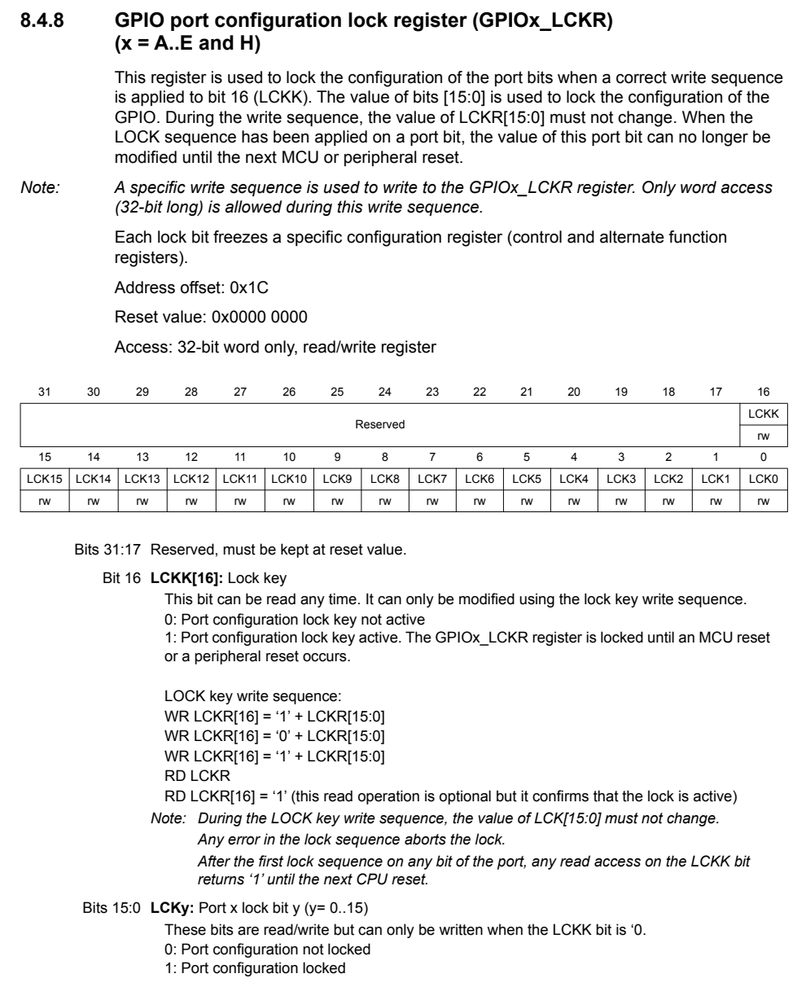  
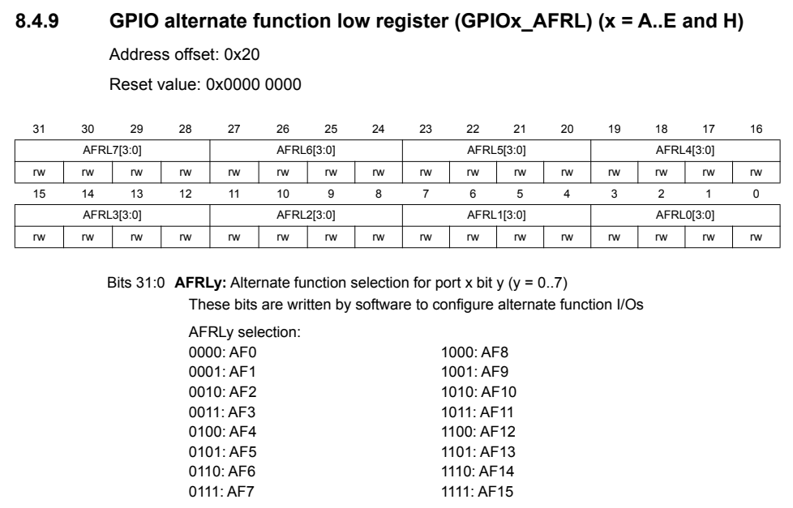  
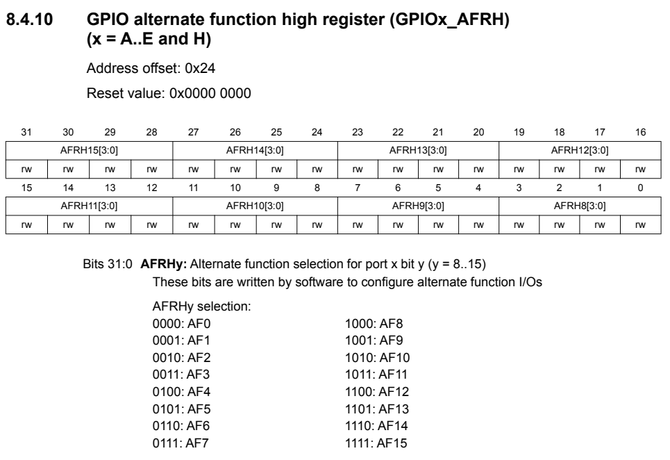  
