# HC-SR04 초음파 거리 센서
---
## Hardware

### 1. STM32F411 Board 
#### 1.1 HC SR04 모형 및 측정 거리 원리 설명

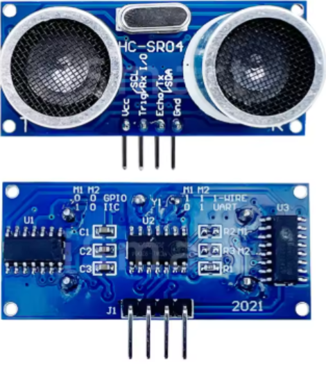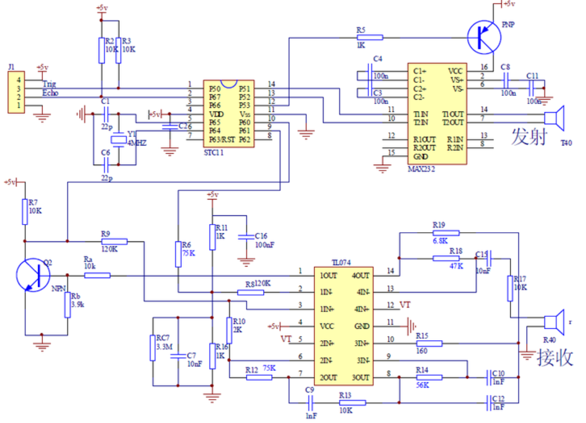 
**"주황색은 전원 및 그라운드 표시, 초록색은 PA0 - Triger, PA1 - Echo, 빨간색은 오실로스코프 측정연결"**
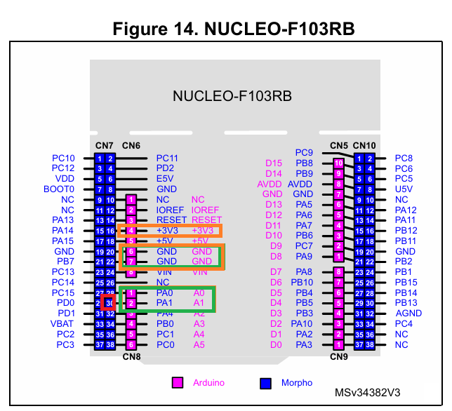

음속 : 초속 약 340m/s

|       |       |
|:-------:|:-------:|
| 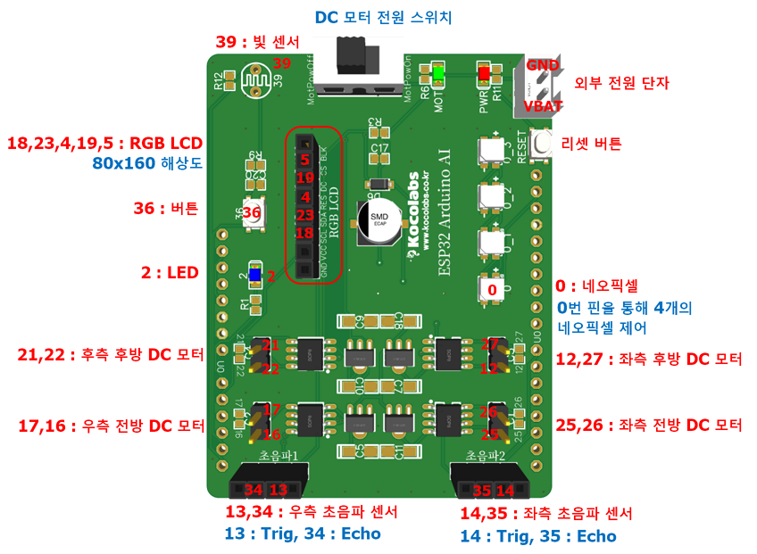 | 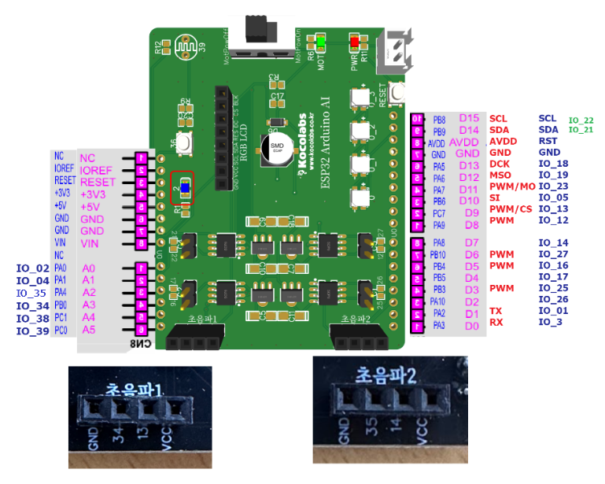 | 

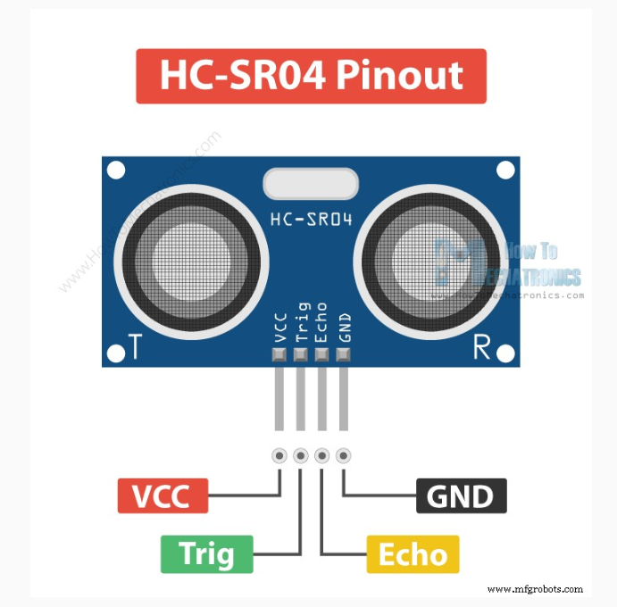 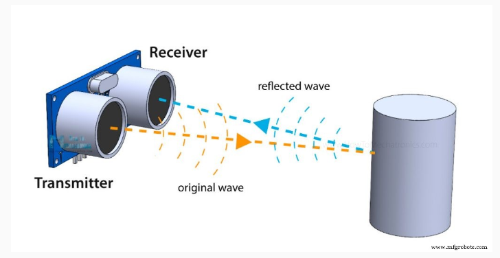

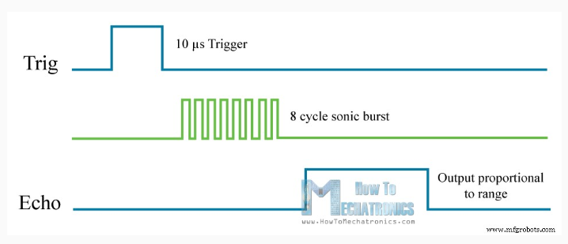 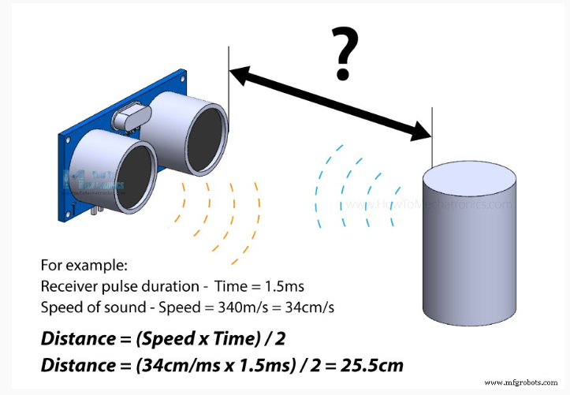


#### 1.2 STM32F411 Board pulse 확인

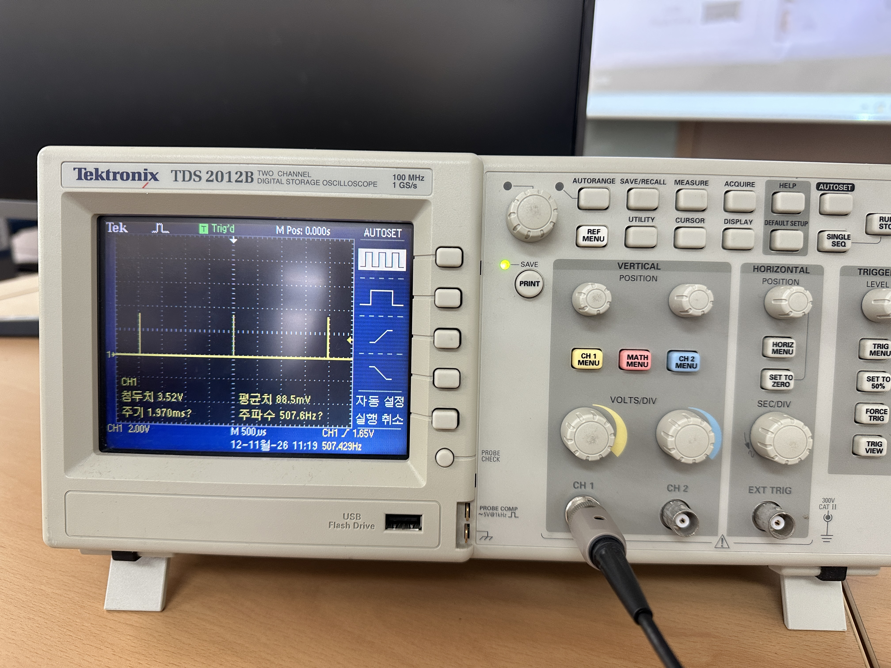<br> **"STM32F411 Oscilloscope pulse"**


### 2. 하드웨어 구성(CUBEMX)

#### 2.1 RCC 설정
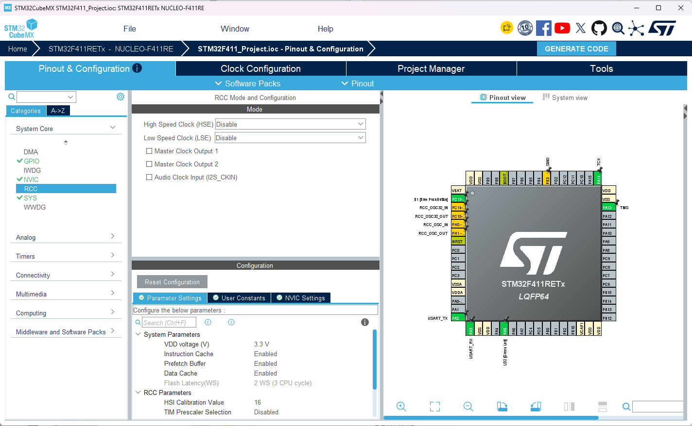<br> **"RCC Disable Setting"**

#### 2.2 PIN Port 설정 
| 핀 | 포트 | 기능 | AF |
|----|------|------|----|
| **ECHO1** | **PA1** | GPIO_Input | TIM1 |
| **TRIGER1** | **PA0** | GPIO Output | — |

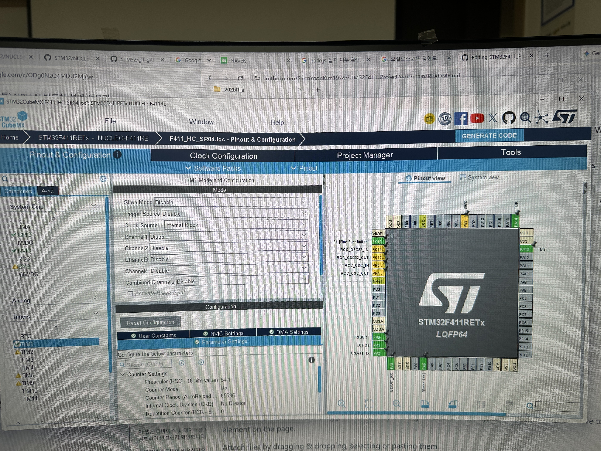<br> **"PIN ECHO TRIGER Setting"**

```
HSI 16MHz → PLL x16 → SYSCLK 84MHz
  ├── AHB (HCLK) = 84MHz (Div1)
      ├── APB1 = 42MHz (Div2) → TIM1 clk = 84MHz (×2, prescaler>1 doubling 규칙)
      └── APB2 = 84MHz (Div1)
  
```

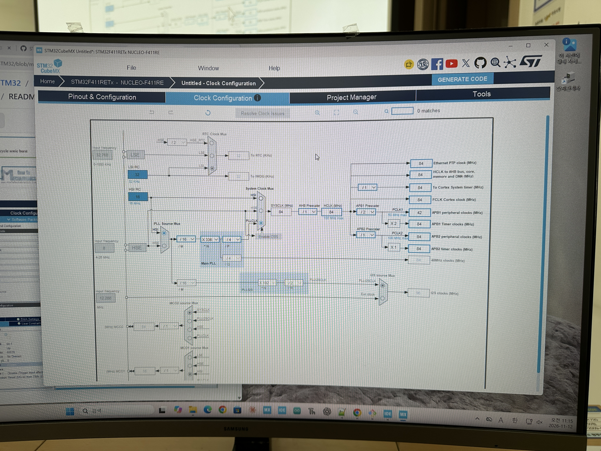<br> **"Clock configuration"**

#### 2.3 TIM1 설정 (CubeMX)

| 파라미터 | 값 | 비고 |
|----------|----|------|
| Clock Source | Internal Clock | — |
| Prescaler | `84-1` | 84MHz ÷ 84 = 1MHz |
| Counter Mode | UP | — |
| Period (ARR) | `65535` | max 65.535ms (1 tick = 1µs) |
| AutoReloadPreload | Enable | — |


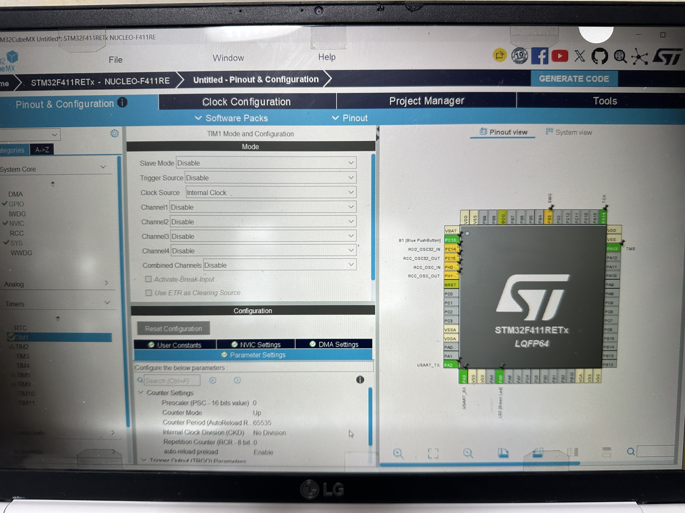<br> **"Timer1 setting"**

#### 2.4 HC-SR04 연결

```
STM32F411                    HC-SR04
  PA0  ───────────────────── TRIGER
  PA1  ───────────────────── ECHO
  VCC  ───────────────────── VCC (3.3V)
  GND  ───────────────────── GND
```
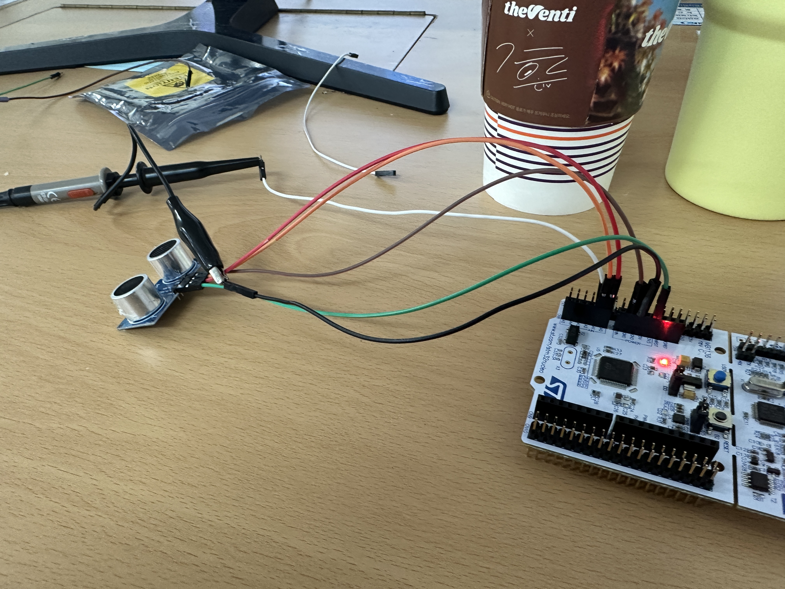<br> **"PIN Oscilloscope Connect"**

## software

### 1. main.c 소스 추가
```c
/* Includes ------------------------------------------------------------------*/
#include "main.h"

/* Private includes ----------------------------------------------------------*/
/* USER CODE BEGIN Includes */
#include <stdio.h>
/* USER CODE END Includes */
```

```c
/* USER CODE BEGIN PD */
#define HIGH 1
#define LOW 0
long unsigned int echo_time;
int dist;
/* USER CODE END PD */
```

```c
/* USER CODE BEGIN 0 */
#ifdef __GNUC__
/* With GCC, small printf (option LD Linker->Libraries->Small printf
   set to 'Yes') calls __io_putchar() */
#define PUTCHAR_PROTOTYPE int __io_putchar(int ch)
#else
#define PUTCHAR_PROTOTYPE int fputc(int ch, FILE *f)
#endif /* __GNUC__ */

/**
  * @brief  Retargets the C library printf function to the USART.
  * @param  None
  * @retval None
  */
PUTCHAR_PROTOTYPE
{
  /* Place your implementation of fputc here */
  /* e.g. write a character to the USART1 and Loop until the end of transmission */
  if (ch == '\n')
    HAL_UART_Transmit (&huart2, (uint8_t*) "\r", 1, 0xFFFF);
  HAL_UART_Transmit (&huart2, (uint8_t*) &ch, 1, 0xFFFF);

  return ch;
}

void timer_start(void)
{
   HAL_TIM_Base_Start(&htim1);
}

void delay_us(uint16_t us)
{
   __HAL_TIM_SET_COUNTER(&htim1, 0); // initislize counter to start from 0
   while((__HAL_TIM_GET_COUNTER(&htim1))<us); // wait count until us
}

void trig(void)
{
   HAL_GPIO_WritePin(TRIG1_GPIO_Port, TRIG1_Pin, HIGH);
   delay_us(10);
   HAL_GPIO_WritePin(TRIG1_GPIO_Port, TRIG1_Pin, LOW);
}

/**
* @brief echo 신호가 HIGH를 유지하는 시간을 (㎲)단위로 측정하여 리턴한다.
* @param no param(void)
*/
long unsigned int echo(void)
{
   long unsigned int echo = 0;

   while(HAL_GPIO_ReadPin(ECHO1_GPIO_Port, ECHO1_Pin) == LOW){}
        __HAL_TIM_SET_COUNTER(&htim1, 0);
        while(HAL_GPIO_ReadPin(ECHO1_GPIO_Port, ECHO1_Pin) == HIGH);
        echo = __HAL_TIM_GET_COUNTER(&htim1);
   if( echo >= 240 && echo <= 23000 ) return echo;
   else return 0;
}
/* USER CODE END 0 */
```

```c
  /* USER CODE BEGIN 2 */
  timer_start();
  printf("Ranging with HC-SR04\n");
  /* USER CODE END 2 */

  /* Infinite loop */
  /* USER CODE BEGIN WHILE */
  while (1)
  {
	  trig();
	      echo_time = echo();
	      if( echo_time != 0){
	          dist = (int)(17 * echo_time / 100);
	          printf("Distance = %d(mm)\n", dist);
	      }
	      else printf("Out of Range!\n");
    /* USER CODE END WHILE */

    /* USER CODE BEGIN 3 */
  }
```

```c
uint32_t echo(void) {
    uint32_t start_tick, start_time, end_time;

    // ECHO HIGH 대기 (최대 10ms)
    start_tick = HAL_GetTick();
    while (HAL_GPIO_ReadPin(ECHO1_GPIO_Port, ECHO1_Pin) == GPIO_PIN_RESET) {
        if ((HAL_GetTick() - start_tick) > 10) return 0;  // 10ms 초과 → 실패
    }
    start_time = __HAL_TIM_GET_COUNTER(&htim1);

    // ECHO LOW 대기 (최대 30ms = HC-SR04 최대 측정 시간)
    start_tick = HAL_GetTick();
    while (HAL_GPIO_ReadPin(ECHO1_GPIO_Port, ECHO1_Pin) == GPIO_PIN_SET) {
        if ((HAL_GetTick() - start_tick) > 30) return 0;  // 30ms 초과 → 범위 초과
    }
    end_time = __HAL_TIM_GET_COUNTER(&htim1);

    return end_time - start_time;
}
```
### 2.초음파 센서 연결 결과 표시
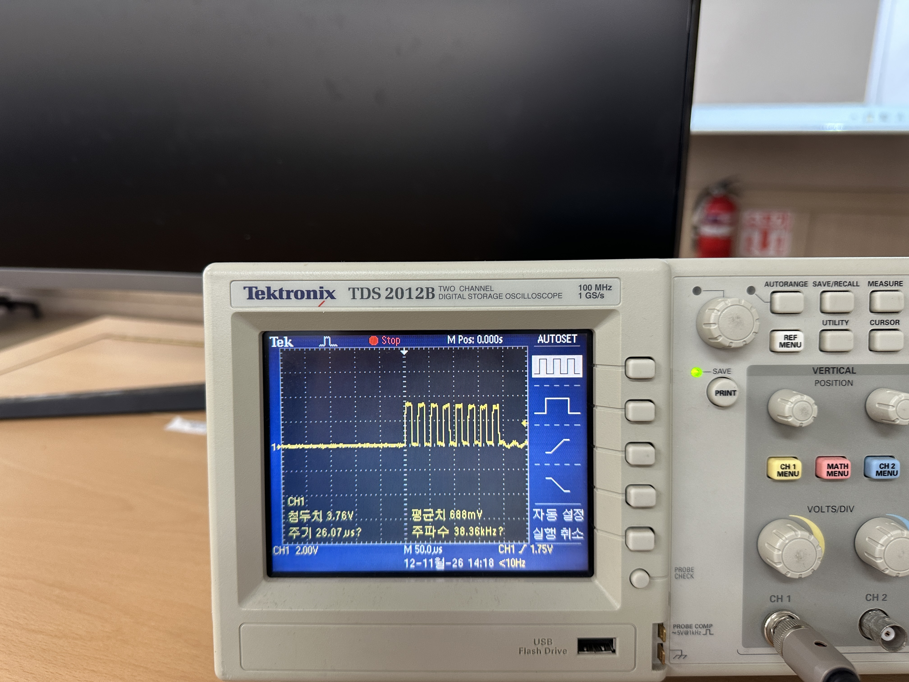<br>
**" 측정 전 초음파 센서 TR 체크 "**


|  **"oscilloscope 확인 결과"**     |  **"putty 확인 결과"**     |
|:-------:|:-------:|
| 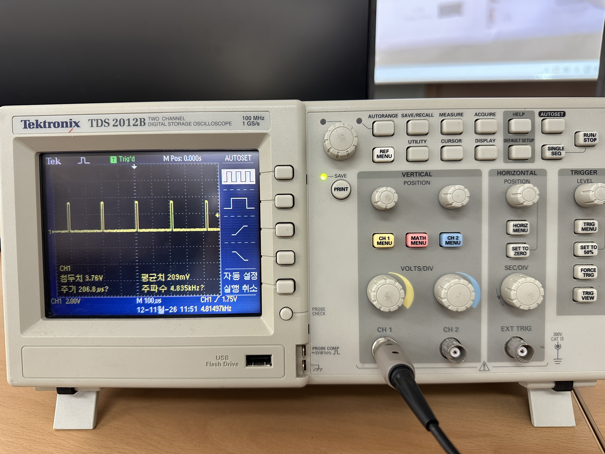 | 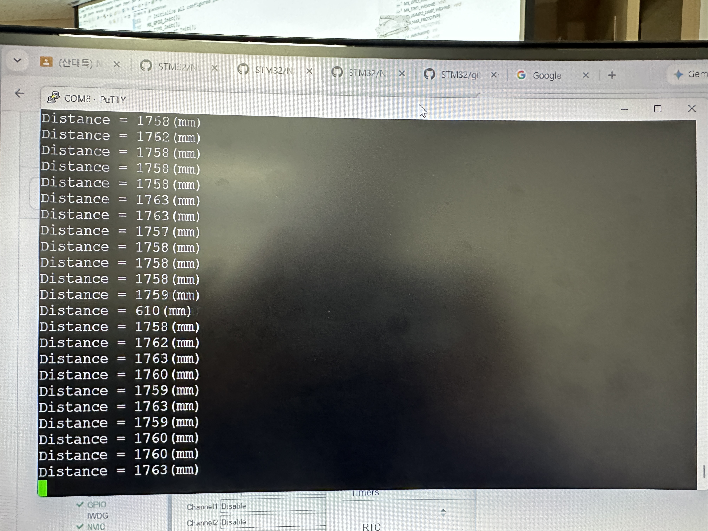 | 

[⬅️ 메인 README.md로 돌아가기](../README.md)

