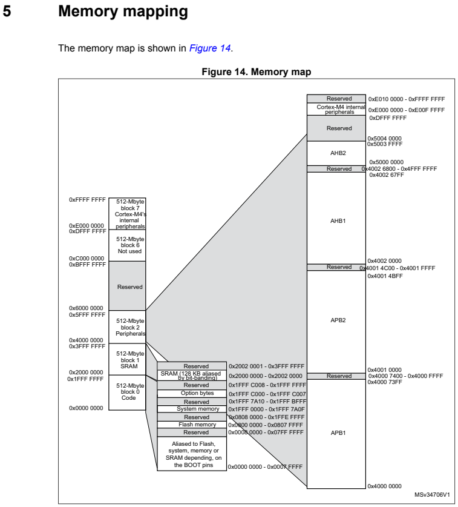
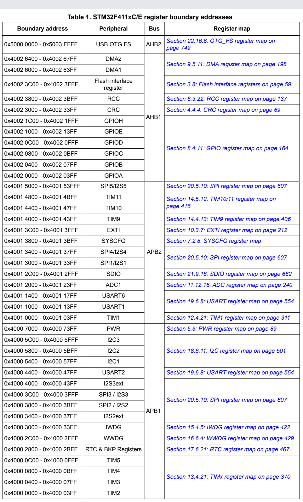
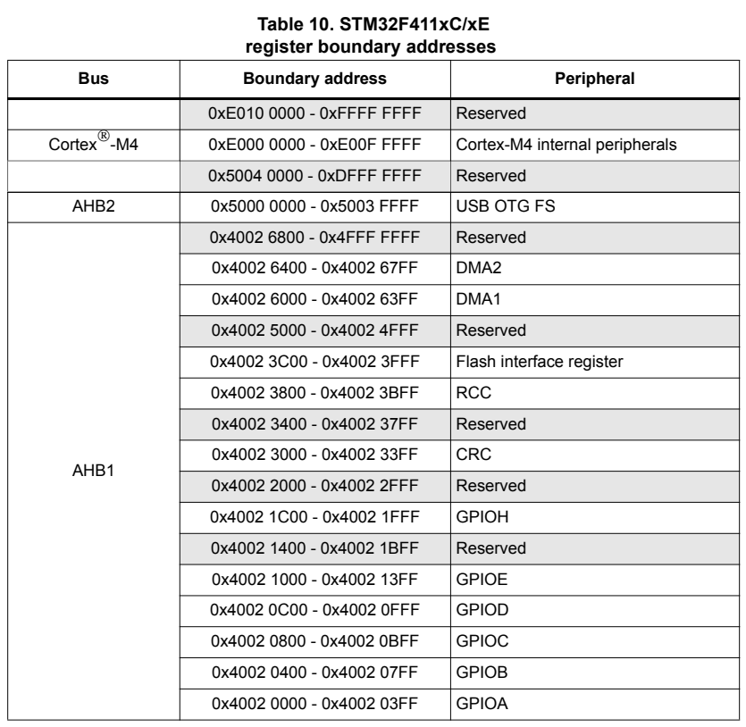
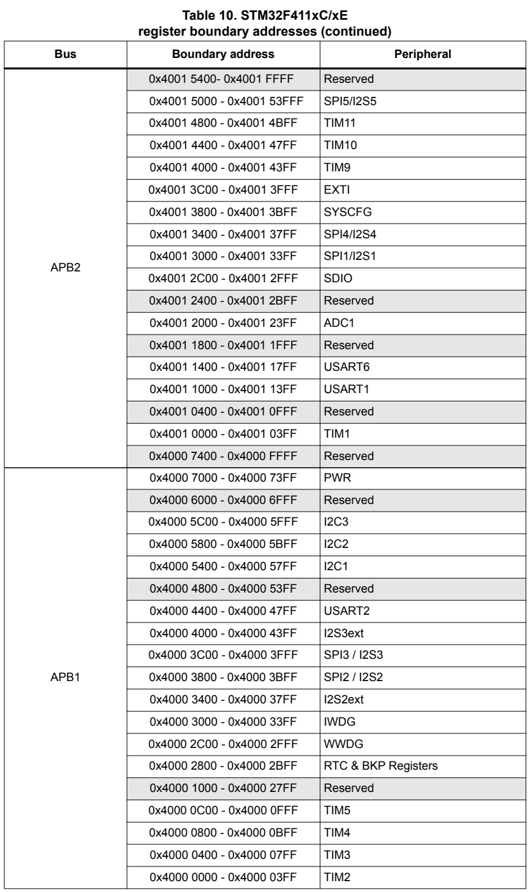

## 2. MemoryMap

### 4.2 메모리 구성

프로그램 메모리, 데이터 메모리, 레지스터 및 I/O 포트는 동일한 4GB 선형 주소 공간 내에 구성됩니다.
메모리 내의 바이트는 리틀 엔디언(little endian) 형식으로 저장됩니다. 워드(word)에서 가장 낮은 주소의 바이트는 최하위 바이트(LSB, least significant byte)로 간주되며, 가장 높은 주소의 바이트는 최상위 바이트(MSB, most significant byte)로 간주됩니다.
주변 장치(peripheral) 레지스터의 상세 매핑에 대해서는 관련 장(chapter)을 참조하십시오. 주소 지정이 가능한 메모리 공간은 각각 512MB 크기의 8개 주요 블록으로 나뉩니다.
온칩(on-chip) 메모리나 주변 장치에 할당되지 않은 모든 메모리 영역은 '예약됨(Reserved)'으로 간주됩니다. 제품 데이터시트에 있는 메모리 맵 그림을 참조하십시오.

### 4.3 메모리 맵

메모리 맵에 대한 전체적인 구성도는 사용 중인 장치의 데이터시트를 참조하십시오. 표 1은 STM32F411xC/E 장치에서 사용할 수 있는 주변 장치들의 경계 주소를 나타냅니다.

#### 2.3.1 내장 SRAM

STM32F411xC/E 디바이스는 128 K바이트의 시스템 SRAM을 갖추고 있습니다.
내장 SRAM은 바이트, 하프 워드(16비트) 또는 풀 워드(32비트) 단위로 액세스할 수 있습니다. 읽기 및 쓰기 작업은 CPU 속도로 수행되며, 대기 상태(wait state)는 0입니다.
SRAM에서 부팅하도록 설정되었거나 물리적 리맵(physical remap)이 선택된 경우, CPU는 시스템 버스 또는 I-Code/D-Code 버스를 통해 내장 SRAM에 액세스할 수 있습니다.
(SYSCFG 컨트롤러 내의 7.2.1절: SYSCFG 메모리 리맵 레지스터(SYSCFG_MEMRMP) 참조). SRAM에서 코드를 실행할 때 최대 성능을 얻으려면 물리적 리맵을 선택해야 합니다(부팅 시 또는 소프트웨어를 통해 설정 가능).

#### 2.3.2  플래시 메모리 개요
플래시 메모리 인터페이스는 CPU의 AHB I-Code 및 D-Code를 통한 플래시 메모리 액세스를 관리합니다. 이 인터페이스는 플래시 메모리의 삭제 및 프로그래밍 작업, 그리고 읽기/쓰기 보호 메커니즘을 구현합니다. 또한 명령어 프리페치(prefetch) 및 캐시 라인 시스템을 통해 코드 실행 속도를 높입니다.
플래시 메모리는 다음과 같이 구성됩니다:
• 섹터로 나뉜 메인 메모리 블록.
• 시스템 메모리 부팅 모드에서 디바이스가 부팅되는 시스템 메모리 영역.
• 사용자 데이터를 위한 512바이트의 OTP(일회성 프로그래밍 가능) 메모리.
• 읽기/쓰기 보호, BOR(Brown-Out Reset) 레벨, 워치독(소프트웨어/하드웨어), 그리고 Standby 또는 Stop 모드에서의 리셋 동작 등을 설정하기 위한 옵션 바이트(Option bytes).
자세한 내용은 3절: 내장 플래시 메모리 인터페이스를 참조하십시오.

#### 2.3.3 비트 밴딩(Bit banding)
FPU가 포함된 Cortex®-M4의 메모리 맵에는 두 개의 비트 밴드 영역이 있습니다. 이 영역들은 '앨리어스(alias) 영역'의 각 워드를 '비트 밴드 영역'의 특정 비트에 매핑합니다. 앨리어스 영역의 워드에 데이터를 쓰는 것은 비트 밴드 영역 내의 대상 비트에 대해 '읽기-수정-쓰기(read-modify-write)' 작업을 수행하는 것과 동일한 효과를 냅니다. STM32F4xx 디바이스에서는 주변 장치 레지스터와 SRAM 모두가 비트 밴드(bit-band) 영역에 매핑되어, 단일 비트 단위의 읽기 및 쓰기 작업이 가능합니다. 이러한 작업은 FPU를 사용하는 Cortex-M4를 통해서만 수행할 수 있으며, 다른 버스 마스터(예: DMA)를 통해서는 수행할 수 없습니다.
매핑 공식을 사용하면 에일리어스(alias) 영역의 각 워드를 비트 밴드 영역의 특정 비트에 대응시킬 수 있습니다. 매핑 공식은 다음과 같습니다.
bit_word_addr = bit_band_base + (byte_offset x 32) + (bit_number × 4)
여기서 각 항목의 의미는 다음과 같습니다.
– bit_word_addr: 대상 비트에 매핑되는 에일리어스 메모리 영역 내 워드의 주소
– bit_band_base: 에일리어스 영역의 시작 주소
– byte_offset: 대상 비트를 포함하고 있는 비트 밴드 영역 내 바이트의 번호(오프셋)
– bit_number: 대상 비트의 위치(0~7)

**예시**
다음 예시는 SRAM 주소 0x20000300에 위치한 바이트의 2번 비트를 별칭 영역(alias region)에 매핑하는 방법을 보여줍니다.
0x22006008 = 0x22000000 + (0x300*32) + (2*4)
주소 0x22006008에 데이터를 쓰는 것은 SRAM 주소 0x20000300에 있는 바이트의 2번 비트에 대해 '읽기-수정-쓰기(read-modify-write)' 작업을 수행하는 것과 동일한 효과를 냅니다.
주소 0x22006008을 읽으면 SRAM 주소 0x20000300에 있는 바이트의 2번 비트 값(0x01 또는 0x00)이 반환됩니다(0x01: 비트 설정됨, 0x00: 비트 해제됨).
비트 밴딩(bit-banding)에 대한 자세한 내용은 'Cortex-M4 with FPU 프로그래밍 매뉴얼'(1페이지의 '관련 문서' 참조)을 확인하십시오.

### 2.4 부팅 구성
고정된 메모리 맵에 따라 코드 영역은 주소 0x0000 0000부터 시작하며(ICode/DCode 버스를 통해 접근), 데이터 영역(SRAM)은 주소 0x2000 0000부터 시작합니다(시스템 버스를 통해 접근). Cortex-M4 with FPU CPU는 항상 ICode 버스를 통해 리셋 벡터를 가져오는데, 이는 부팅 공간이 코드 영역(일반적으로 플래시 메모리)에만 존재해야 함을 의미합니다. STM32F4xx 마이크로컨트롤러는 다른 메모리(내부 SRAM 등)에서도 부팅할 수 있도록 특별한 메커니즘을 구현하고 있습니다.
STM32F4xx에서는 표 2에 나타난 바와 같이 BOOT[1:0] 핀을 통해 세 가지 부팅 모드 중 하나를 선택할 수 있습니다. 

BOOT 핀의 값은 리셋 후 SYSCLK의 4번째 상승 에지(rising edge)에서 래치(latch)됩니다. 사용자는 리셋 후 BOOT1 및 BOOT0 핀을 설정하여 원하는 부팅 모드를 선택해야 합니다.
BOOT0는 전용 핀인 반면, BOOT1은 GPIO 핀과 공유됩니다. BOOT1 값이 샘플링되고 나면, 해당 GPIO 핀은 자유 상태가 되어 다른 용도로 사용할 수 있습니다.
장치가 대기(Standby) 모드에서 빠져나올 때도 BOOT 핀을 다시 샘플링합니다. 따라서 장치가 대기 모드에 있는 동안에도 원하는 부팅 모드 설정 상태를 유지해야 합니다. 이러한 시작 지연(startup delay)이 끝나면, CPU는 주소 0x0000 0000에서 스택 최상단(top-of-stack) 값을 가져온 다음, 0x0000 0004부터 시작되는 부팅 메모리 영역에서 코드 실행을 시작합니다.

참고: 장치가 SRAM에서 부팅되는 경우, 애플리케이션 초기화 코드 내에서 NVIC 예외 테이블과 오프셋 레지스터를 사용하여 SRAM 내의 벡터 테이블을 재배치(relocate)해야 합니다.

**내장 부트로더(Embedded bootloader)**
내장 부트로더 모드는 다음 직렬 인터페이스 중 하나를 사용하여 플래시 메모리를 재프로그래밍하는 데 사용됩니다.
• USART1 (PA9/PA10)
• USART2 (PD5/PD6)
• I2C1 (PB6/PB7)
• I2C2 (PB10/PB3)
• I2C3 (PA8/PB4)
• SPI1 (PA4/PA5/PA6/PA7)
• SPI2 (PB12/PB13/PB14/PB15)
• SPI3 (PA15/PC10/PC11/PC12)
• USB OTG FS (PA11/12) - 디바이스 모드(DFU: Device Firmware Upgrade)
USART 주변 장치는 내부 16 MHz 오실레이터(HSI) 주파수에서 작동하며, USB OTG FS는 1 MHz의 배수인 외부 클록(HSE, 4~26 MHz 범위)을 필요로 합니다. 내장 부트로더 코드는 시스템 메모리에 위치하며, 제조 과정에서 ST에 의해 프로그래밍됩니다. 자세한 내용은 애플리케이션 노트 AN2606을 참조하십시오.

**STM32F411xC/E에서의 물리적 리맵(Physical remap)**
부트 핀이 선택되면, 애플리케이션 소프트웨어는 코드 영역에서 접근 가능한 메모리를 수정할 수 있습니다(이를 통해 코드는 시스템 버스 대신 ICode 버스를 통해 실행될 수 있습니다). 이러한 수정은 SYSCFG 컨트롤러 내의 '7.2.1절: SYSCFG 메모리 리맵 레지스터(SYSCFG_MEMRMP)'를 프로그래밍함으로써 수행됩니다.
다음 메모리들을 리맵할 수 있습니다.
• 메인 플래시 메모리(Main Flash memory)
• 시스템 메모리(System memory)
• 내장 SRAM1(Embedded SRAM1)
임베디드 플래시 메모리 인터페이스

### 3.1 개요
플래시 메모리 인터페이스는 CPU의 AHB I-Code 및 D-Code를 통한 플래시 메모리 접근을 관리합니다. 이 인터페이스는 플래시 메모리의 삭제 및 프로그래밍 작업과 읽기/쓰기 보호 메커니즘을 구현합니다.
또한, 명령어 프리페치(prefetch) 및 캐시 라인 시스템을 통해 코드 실행 속도를 향상시킵니다.

### 3.2 주요 특징
• 플래시 메모리 읽기 작업
• 플래시 메모리 프로그래밍/삭제 작업
• 읽기/쓰기 보호 기능
• I-Code에 대한 프리페치(prefetch) 기능
• I-Code용 128비트 캐시 라인 64개
• D-Code용 128비트 캐시 라인 8개

그림 2는 시스템 아키텍처 내에서 플래시 메모리 인터페이스가 어떻게 연결되어 있는지 보여줍니다.

  
  
  
  

[⬅️ 메인 README.md로 돌아가기](../README.md)
