디버그를 시작합니다.

#### 1.	Add Watch Expression 을통해서 "LD2_GPIO_Port"을 추가한다.
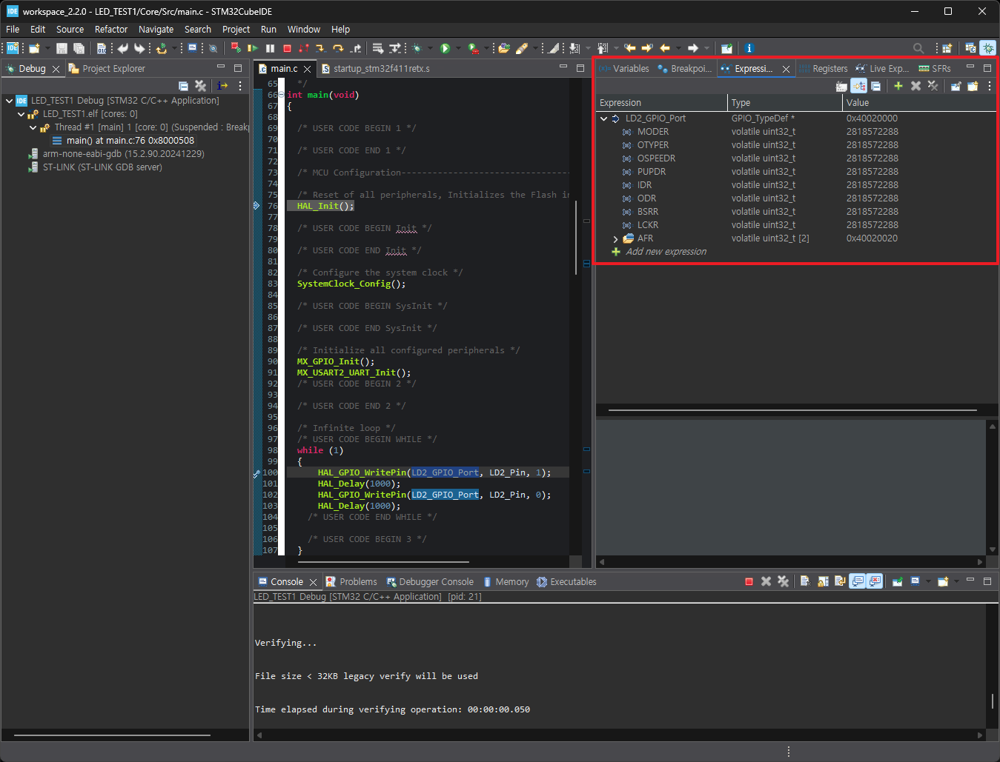 <br>

#### 2.	SFR 레지스터를 확인합니다.
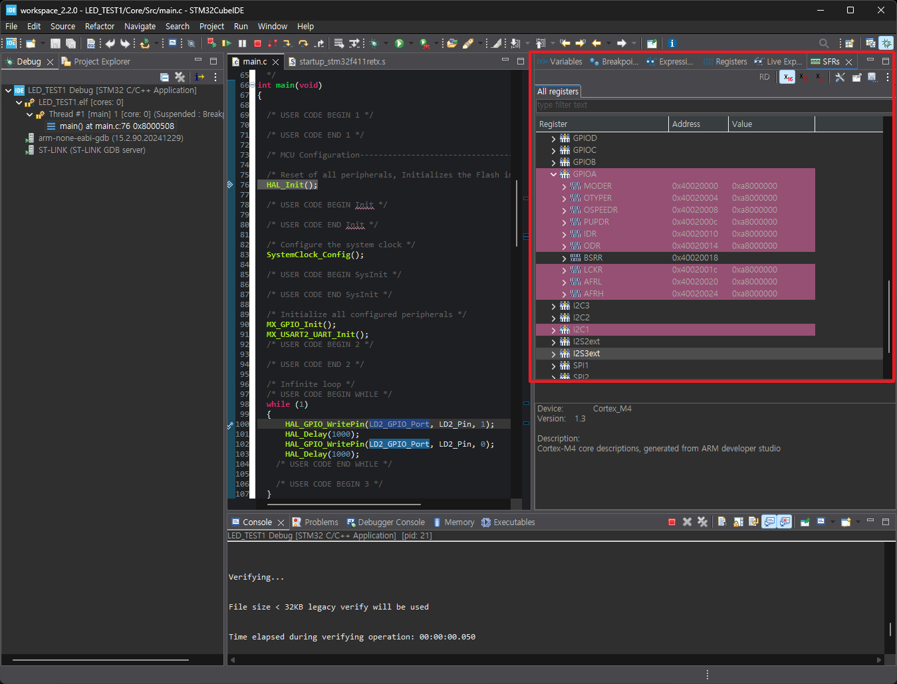 <br>

임베디드 시스템과 마이크로컨트롤러(MCU) 세계에서 SFR은 Special Function Register(특수 기능 레지스터)의 약자입니다.

방금 우리가 이야기 나눈 MODER, OTYPER, ODR, IDR 같은 레지스터들이 바로 대표적인 SFR입니다!

SFR에 대해 핵심만 요약해 드리면 다음과 같습니다.

* 1. SFR이란 무엇인가요?
소프트웨어와 하드웨어를 잇는 다리: CPU(소프트웨어)가 MCU 내부의 주변장치(GPIO, 타이머, 통신 포트 등)를 제어하거나 상태를 읽어올 수 있도록 메모리 주소가 할당된 특별한 목적의 레지스터 공간입니다.

예를 들어, STM32에서 특정 GPIO 핀을 출력으로 만들고 싶다면 GPIOC->MODER라는 SFR 주소에 특정 값(01)을 써넣으면 됩니다. 그러면 하드웨어 회로(첫 번째 그림의 스위치와 게이트들)가 그에 맞춰 실제로 움직입니다.

* 2. 일반 메모리(RAM)와는 무엇이 다를까요?
일반 RAM: 프로그램이 실행되면서 변수를 저장하고 지우는 일반적인 작업 공간입니다.

SFR: 저장 공간이긴 한데, 이 공간에 값을 쓰거나 읽는 행위 자체가 하드웨어(회로, 핀 전압, 통신 송수신 등)를 직접 제어하게 됩니다. (이를 메모리 맵 I/O (Memory-Mapped I/O) 방식이라고 부릅니다.)

#### 3. MCU 코어의 Register 라는 정보도 볼 수 있습니다.

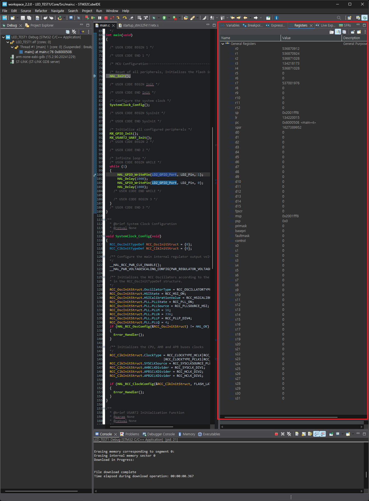 <br>

**Window > Show View > Othrer > Disassembly**

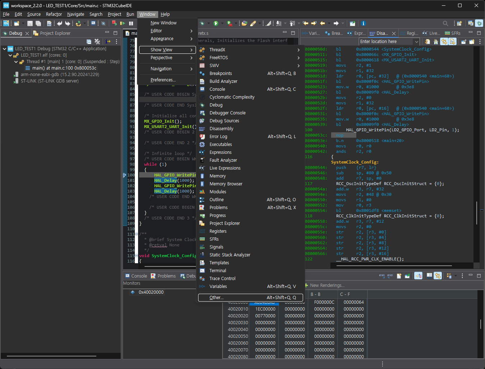 <br>

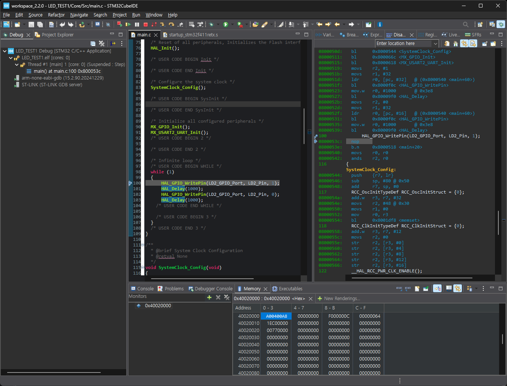 <br>

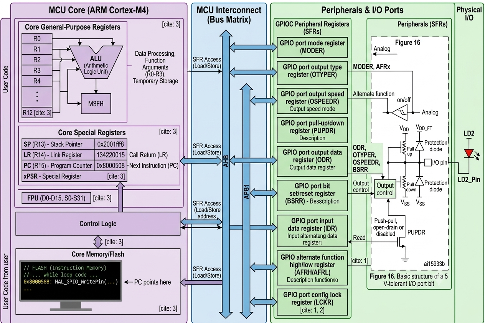 <br>

* 위의 그림은 코어 레지스터(Core Registers / General-purpose & Special Registers) 화면입니다.

* 앞서 살펴본 SFR(특수 기능 레지스터)이 주변장치(GPIO 등)를 제어하기 위한 "외부 부품용 제어판"이었다면, 이 화면에 나오는 레지스터들은 CPU 코어 자체가 연산을 수행하고 프로그램을 제어하기 위해 내부에 가지고 있는 핵심 작업 공간입니다.

* 이 레지스터들의 역할과 기능, 그리고 제공해주신 HAL_GPIO_WritePin 코드(LED Blink)가 실행될 때 이 레지스터들이 구체적으로 어떻게 움직이는지 예시를 들어 정리해 드리겠습니다.

* 1. 주요 코어 레지스터의 역할과 기능

	* R0 ~ R12 (General Purpose Registers, 범용 레지스터)
  		* 역할: 데이터 연산, 임시 값 저장, 함수 인자 전달 및 반환값 저장 등 가장 범용적으로 쓰이는 공간입니다.
		* 기능: C언어로 작성한 코드가 컴파일되면 CPU가 이해하는 어셈블리어로 바뀌는데, 이때 변수 값이나 주소값을 여기에 임시로 올려두고 계산합니다.

	* SP (Stack Pointer, R13): MSP / PSP
		* 역할: 함수 호출 시 지역 변수나 복귀 주소를 저장하는 메모리 공간(스택)의 현재 위치를 가리키는 포인터입니다.
  		* 기능: 코드가 실행되면서 함수가 중첩될 때마다 스택이 쌓이고 해제되는 위치를 기억합니다. (이미지에서 msp 값이 0x2001fff8로 지정되어 있는 것을 볼 수 있습니다.)
		
    * LR (Link Register, R14)
    	* 역할: 함수가 끝난 후 다시 돌아갈 원래 위치(복귀 주소)를 기억하는 레지스터입니다.
     	* 기능: 예를 들어 main() 함수 안에서 HAL_Delay() 함수를 호출하러 갈 때, "일이 끝나면 다시 main의 이 자리로 돌아와야 한다"는 주소를 LR에 저장해 둡니다.
		
	* PC (Program Counter, R15)
 		* 역할: CPU가 현재 실행하고 있는 명령어의 메모리 주소를 가리킵니다.
   		* 기능: 이미지를 보면 pc 값이 0x8000508 <main+4>로 되어 있는데, 이는 현재 CPU가 플래시 메모리의 0x8000508 번지에 있는 기계어 명령어를 읽어서 실행하고 있음을 뜻합니다.
		
	* D0 ~ D15, S0 ~ S31 (FPU / SIMD Registers)
		* 역할: Cortex-M4 코어에 내장된 FPU(부동소수점 연산 장치)를 위한 레지스터입니다. 소수점 연산(float, double)을 할 때 사용됩니다.

* 2. 제시해주신 코드(HAL_GPIO_WritePin) 동작 시 레지스터들의 작동 예시제시해주신 코드는 1초 간격으로 LED를 켜고 끄는 반복문입니다.   C  while (1)

```
{
	  HAL_GPIO_WritePin(LD2_GPIO_Port, LD2_Pin, 1);
	  HAL_Delay(1000);
	  ...
  }
```

* 이 코드가 한 줄씩 실행될 때 코어 레지스터들이 어떻게 상호작용하는지 단계별 예시로 살펴보겠습니다.

① PC (Program Counter)의 이동
   * CPU는 while(1) 루프 내부의 명령어들을 순차적으로 실행합니다. 이때 PC 값은 실행할 명령어의 주소에 따라 계속 바뀝니다. HAL_GPIO_WritePin 함수를 호출하는 순간, PC는 해당 함수가 저장된 플래시 메모리 주소로 점프합니다.

② LR (Link Register)의 백업
   * main() 함수에서 HAL_GPIO_WritePin() 함수로 점프하기 직전, CPU는 "함수 처리가 끝나고 돌아올 복귀 주소(main의 다음 줄 주소)"를 자동으로 LR 레지스터에 저장합니다. 함수가 끝나면 PC에 LR의 값을 다시 덮어써서 main으로 안전하게 돌아옵니다.

③ R0 ~ R3 (함수 인자 전달)
   * C언어 함수인 HAL_GPIO_WritePin(LD2_GPIO_Port, LD2_Pin, 1)을 호출할 때, 전달해야 하는 매개변수들(포트 주소, 핀 번호, 출력할 값 1)은 범용 레지스터 R0, R1, R2 등에 나누어 담겨 함수 내부로 전달됩니다.

④ SFR(특수 기능 레지스터)과의 최종 만남
   * HAL_GPIO_WritePin 내부 코드가 실행되면, 전달받은 인자들을 바탕으로 앞서 이야기했던 GPIO의 ODR(Output Data Register) 같은 SFR 메모리 주소에 실제 값(1 또는 0)을 쓰게 됩니다.
   * 그 결과, MCU 내부의 하드웨어 회로(첫 번째 이미지의 ODR과 출력 드라이버)가 반응하여 실제 핀 전압이 High(1) 또는 Low(0)로 바뀌고, 연결된 LED(LD2)가 켜지거나 꺼지게 됩니다.

💡 한눈에 보는 요약

* Core Registers (방금 보신 이미지): CPU가 코드를 실행하고, 함수를 호출하고, 연산을 처리하기 위해 사용하는 CPU 내부의 두뇌 작업 공간입니다.   
* SFR (앞서 이야기한 MODER, ODR 등): CPU가 주변장치(LED가 연결된 GPIO 핀 등)를 제어하기 위해 외부(메모리 맵)에 마련해 둔 하드웨어 제어판입니다.
* 동작 흐름: CPU가 Core Register를 이용해 계산하고 명령을 내려 SFR의 값을 바꾸면, 그에 따라 핀의 물리적 상태가 변합니다.

---

#### 오실로스코프로 측정한 결과
| **LED On 결과** | **LED Off 결과** |
| :---: | :---: |
| 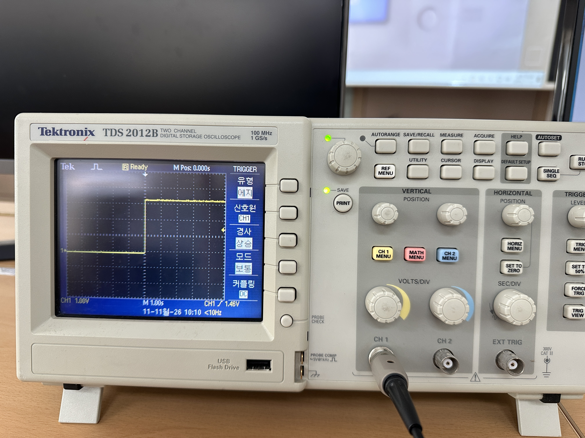 | 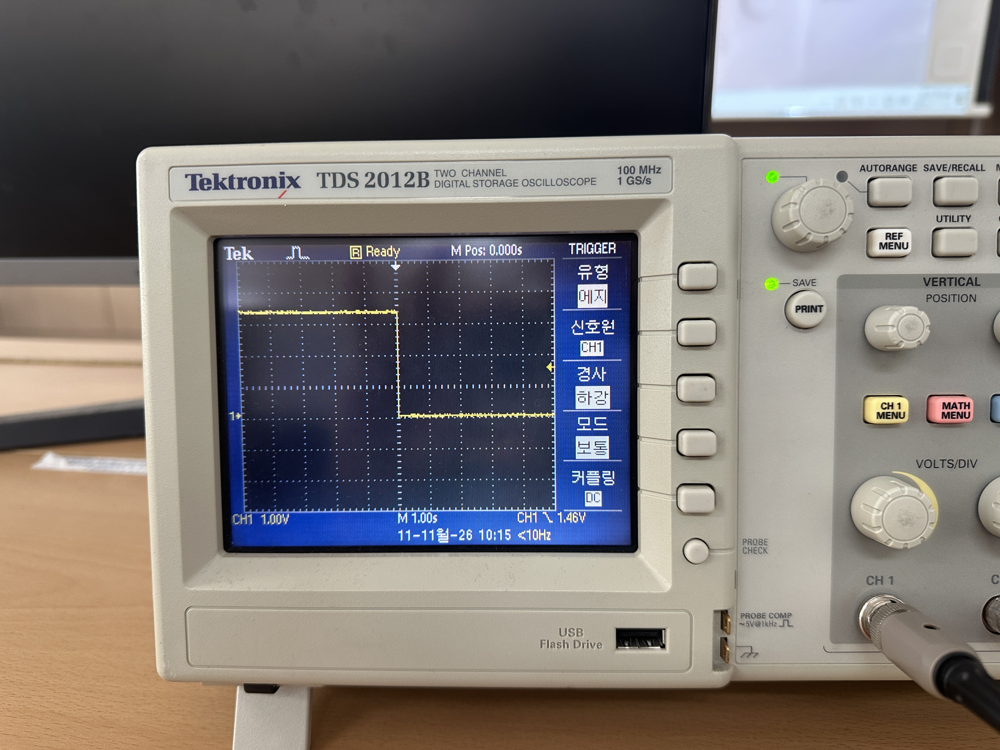 |

## 🎬 상황 설정: "지금 당장 불을 켜라!" (LED 제어 명령)

우리의 머리(CPU 코어)는 플래시 메모리에 적힌 "1초마다 LED를 켜고 꺼라"라는 레시피(프로그램)를 읽으며 하루를 시작합니다.

### 1단계: 어디까지 읽었더라? (PC - Program Counter)

* CPU의 혼잣말: "자, 지금 내가 어디를 읽을 차례지? 아, 플래시 메모리의 0x8000508 번지 차례구나.
* 동작: PC(Program Counter) 레지스터가 현재 실행해야 할 명령어의 주소를 가리킵니다. 이 주소를 따라 메모리에서 "LED 켜기 함수를 불러라"라는 명령어를 꺼내옵니다.   

### 2단계: 다녀오면 어디로 돌아가지? (LR - Link Register)

* CPU의 혼잣말: "잠시 HAL_GPIO_WritePin이라는 부서(함수)에 다녀와야겠어. 업무가 끝나면 까먹지 말고 지금 이 자리(main 함수의 다음 줄)로 다시 돌아와야 하니까, 복귀 주소를 수첩에 적어둬야지.
* 동작: LR(Link Register)에 복귀 주소가 백업됩니다. 그리고 PC는 점프하여 HAL_GPIO_WritePin 함수가 시작되는 주소로 이동합니다.

### 3단계: 일꾼들에게 재료 전달하기 (R0 ~ R3 - 범용 레지스터)

* CPU의 혼잣말: *"불을 켜긴 켜야 하는데, 어떤 핀(LD2_Pin)에 어떤 포트(LD2_GPIO_Port)를 써서, 몇 번 값(1, 켠다)*을 보내야 하는지 알바생(함수 내부 로직)들에게 전달해 줘야겠어.
* 동작: 함수에 전달할 매개변수 값들이 R0, R1, R2 같은 범용 레지스터들에 척척 담깁니다. 알바생들은 이 레지스터들을 열어보고 "아, 포트 C의 5번 핀에 '1'을 보내라는 거구나!" 하고 이해합니다.   

### 4단계: 버스 타고 하드웨어 제어판으로 출동! (AHB/APB Bus & SFR)

* CPU의 혼잣말: "이제 계산은 끝났어. 이 명령을 실제 하드웨어에 전달해야 해. 버스(Bus)라는 고속도로를 타고 빛의 속도로 GPIO 제어판(SFR)으로 가자!
* 동작: CPU 코어를 떠난 신호가 버스 매트릭스를 타고 날아가, GPIO 포트의 ODR(Output Data Register) 또는 BSRR이라는 특수 기능 레지스터(SFR)의 문을 두드립니다.

### 5단계: 제어판 스위치 조작과 물리적 전압 변화 (SFR ➔ I/O Pin)

* 하드웨어의 반응:"오호, ODR 레지스터의 해당 비트에 1이 들어왔네?"
* 이 신호가 첫 번째 그림에서 보았던 내부 회로(출력 제어기, P-MOS 트랜지스터)의 게이트를 콱 열어젖힙니다.   
* 그 결과, MCU 칩 외부로 나가는 LD2_Pin의 물리적 전압이 0V(Low)에서 3.3V(High)로 훅 뛰어오릅니다.   

### 6단계: 결과 확인 및 대기 (Delay와 다음 루프)

* LED의 반응: 전기가 통과하면서 기판에 붙어 있는 초록색 LED(LD2)에 불이 번쩍 들어옵니다!
* CPU의 혼잣말: "자, 불이 켜졌으니 1초 동안 아무것도 안 하고 기다리자(HAL_Delay). 1초가 지나면 다시 PC를 다음 줄로 옮겨서 이번엔 끄는 명령(0)을 보내야지."

---

```asm
          main:
08000505:   push    {r7, lr}
08000507:   add     r7, sp, #0
08000509:   bl      0x800090c <HAL_Init>
0800050d:   bl      0x8000544 <SystemClock_Config>
08000511:   bl      0x800066c <MX_GPIO_Init>
08000515:   bl      0x8000618 <MX_USART2_UART_Init>
08000519:   movs    r2, #1
0800051b:   movs    r1, #32
0800051d:   ldr     r0, [pc, #32]   @ (0x8000540 <main+60>)
0800051f:   bl      0x8000f0c <HAL_GPIO_WritePin>
08000523:   mov.w   r0, #1000       @ 0x3e8
08000527:   bl      0x80009f0 <HAL_Delay>
0800052b:   movs    r2, #0
0800052d:   movs    r1, #32
0800052f:   ldr     r0, [pc, #16]   @ (0x8000540 <main+60>)
08000531:   bl      0x8000f0c <HAL_GPIO_WritePin>
08000535:   mov.w   r0, #1000       @ 0x3e8
08000539:   bl      0x80009f0 <HAL_Delay>
100       	  HAL_GPIO_WritePin(LD2_GPIO_Port, LD2_Pin, 1);
0800053c:   nop     
0800053e:   b.n     0x8000518 <main+20>
08000540:   movs    r0, r0
08000542:   ands    r2, r0
```

### 1단계: LED 켜기 명령 준비 및 전달 (R0, R1, R2 레지스터 사용)

코드가 실행되면서 인자(재료)들을 범용 레지스터에 차곡차곡 담습니다.

```asm
코드 스니펫
08000519:    movs    r2, #1               ; R2 레지스터에 '1' 대입 (불을 켜라는 값)
0800051b:    movs    r1, #32              ; R1 레지스터에 핀 번호 대입 (예: 32번 비트/핀)
0800051d:    ldr     r0, [pc, #32]        ; R0 레지스터에 포트 주소(예: GPIOA 주소)를 불러옴
0800051f:    bl      0x8000f0c <HAL_GPIO_WritePin> ; 이 함수를 호출!
```

동작 설명: CPU가 R0(포트), R1(핀), R2(값 1)에 제어 정보를 담아서 HAL_GPIO_WritePin 함수로 던져줍니다. 이 함수가 내부적으로 앞서 말씀드린 SFR(ODR 레지스터)에 값을 써서 핀 전압을 3.3V(High)로 띄우고 LED가 켜집니다.

### 2단계: 1초 동안 기다리기 (HAL_Delay)

```asm
코드 스니펫
08000523:    mov.w   r0, #1000            ; R0 레지스터에 1000(밀리초, 1초) 세팅
08000527:    bl      0x80009f0 <HAL_Delay>  ; 딜레이 함수 호출
```

동작 설명: 불이 켜진 상태로 CPU가 아무것도 안 하고 1초 동안 대기합니다.

### 3단계: LED 끄기 명령 준비 및 전달
이번에는 끄기(0) 값으로 바꾸어 똑같이 함수를 호출합니다.

```asm
코드 스니펫
0800052b:    movs    r2, #0               ; R2 레지스터에 '0' 대입 (불을 끄라는 값!)
0800052d:    movs    r1, #32              ; 핀 번호 (유지)
0800052f:    ldr     r0, [pc, #16]        ; 포트 주소 (유지)
08000531:    bl      0x8000f0c <HAL_GPIO_WritePin> ; 다시 함수 호출!
```

동작 설명: 이번엔 R2에 0이 담겼습니다. HAL_GPIO_WritePin이 실행되면서 SFR(ODR 레지스터)의 값이 0으로 바뀌고, 핀 전압이 0V(Low)로 떨어지며 LED가 꺼집니다.

### 4단계: 다시 1초 대기 후 무한 반복 (b.n)

```asm
코드 스니펫
08000535:    mov.w   r0, #1000            ; 1000(1초) 세팅
08000539:    bl      0x80009f0 <HAL_Delay>  ; 딜레이 함수 호출
0800053c:    nop                          ; 빈 클럭 소모 (No Operation)
0800053e:    b.n     0x8000518 <main+20>  ; 위쪽(첫 번째 줄)으로 점프하여 무한 반복!
```

동작 설명: 1초를 더 기다린 뒤, b.n(Branch) 명령어를 만나 코드가 다시 맨 위로 되돌아갑니다. 이 과정이 계속 반복되면서 LED가 깜빡이게 됩니다.

```asm
          HAL_GPIO_WritePin:
08000f0c:   push    {r7}
08000f0e:   sub     sp, #12
08000f10:   add     r7, sp, #0
08000f12:   str     r0, [r7, #4]
08000f14:   mov     r3, r1
08000f16:   strh    r3, [r7, #2]
08000f18:   mov     r3, r2
08000f1a:   strb    r3, [r7, #1]
416         if(PinState != GPIO_PIN_RESET)
08000f1c:   ldrb    r3, [r7, #1]
08000f1e:   cmp     r3, #0
08000f20:   beq.n   0x8000f2a <HAL_GPIO_WritePin+30>
418           GPIOx->BSRR = GPIO_Pin;
08000f22:   ldrh    r2, [r7, #2]
08000f24:   ldr     r3, [r7, #4]
08000f26:   str     r2, [r3, #24]
424       }
08000f28:   b.n     0x8000f32 <HAL_GPIO_WritePin+38>
422           GPIOx->BSRR = (uint32_t)GPIO_Pin << 16U;
08000f2a:   ldrh    r3, [r7, #2]
08000f2c:   lsls    r2, r3, #16
08000f2e:   ldr     r3, [r7, #4]
08000f30:   str     r2, [r3, #24]
424       }
08000f32:   nop     
08000f34:   adds    r7, #12
08000f36:   mov     sp, r7
08000f38:   ldr.w   r7, [sp], #4
08000f3c:   bx      lr
08000f3e:   movs    r0, r0
```

1. HAL_GPIO_WritePin 함수 내부의 핵심 동작 (불 켜기/끄기)

* 인자값 저장: main에서 R0(포트 주소), R1(핀 번호), R2(1 또는 0)로 넘겨준 값들을 함수 내부의 임시 공간(스택, [r7, #...])에 안전하게 백업해 둡니다. (0x8000f12 ~ 0x8000f1a)
* 조건 분기 (if문):
	* 0x8000f1c: 전달받은 값이 0인지 아닌지 비교(cmp r3, #0)합니다.
 	* 불을 켤 때 (1): 0x8000f26의 str r2, [r3, #24]를 통해 포트 주소로부터 +24번째 오프셋(BSRR 레지스터)에 그대로 값을 써서 핀을 High(3.3V)로 만듭니다.
  	* 불을 끌 때 (0): 0x8000f2c에서 그 값을 왼쪽으로 16칸 밀치고(lsls r2, r3, #16), 똑같이 BSRR 레지스터(+24)에 써서 핀을 Low(0V)로 떨어뜨립니다. (STM32의 BSRR 특성상 하위 16비트는 Set, 상위 16비트는 Reset 역할을 합니다.)


```asm
          HAL_Delay:
080009f0:   push    {r7, lr}
080009f2:   sub     sp, #16
080009f4:   add     r7, sp, #0
080009f6:   str     r0, [r7, #4]
392         uint32_t tickstart = HAL_GetTick();
080009f8:   bl      0x80009d8 <HAL_GetTick>
080009fc:   str     r0, [r7, #8]
393         uint32_t wait = Delay;
080009fe:   ldr     r3, [r7, #4]
08000a00:   str     r3, [r7, #12]
396         if (wait < HAL_MAX_DELAY)
08000a02:   ldr     r3, [r7, #12]
08000a04:   cmp.w   r3, #4294967295
08000a08:   beq.n   0x8000a16 <HAL_Delay+38>
398           wait += (uint32_t)(uwTickFreq);
08000a0a:   ldr     r3, [pc, #40]   @ (0x8000a34 <HAL_Delay+68>)
08000a0c:   ldrb    r3, [r3, #0]
08000a0e:   mov     r2, r3
08000a10:   ldr     r3, [r7, #12]
08000a12:   add     r3, r2
08000a14:   str     r3, [r7, #12]
401         while((HAL_GetTick() - tickstart) < wait)
08000a16:   nop     
08000a18:   bl      0x80009d8 <HAL_GetTick>
08000a1c:   mov     r2, r0
08000a1e:   ldr     r3, [r7, #8]
08000a20:   subs    r3, r2, r3
08000a22:   ldr     r2, [r7, #12]
08000a24:   cmp     r2, r3
08000a26:   bhi.n   0x8000a18 <HAL_Delay+40>
404       }

를 콜하는건가?
```

2. HAL_Delay 함수 내부의 핵심 동작 (1초 대기)

* 시간 측정 시작 (tickstart):
	* 0x8000f98: HAL_GetTick() 함수를 불러서 "지금 현재 시간(틱 카운트)"이 얼마인지 확인하고 tickstart에 저장합니다.

* 대기 시간 계산 (wait):
	* 0x80009fe: main에서 넘겨준 1000(ms)을 대기 시간(wait)으로 잡습니다.

* 반복문 대기 (while):
	* 0x8000a18 ~ 0x8000a26: 끊임없이 현재 시간을 다시 가져와서(HAL_GetTick()), (현재 시간 - 시작 시간) < 1000 조건을 만족할 때까지 계속 제자리에서 돌며(bhi.n) 시간을 떼웁니다. 1초가 지나면 이 루프를 빠져나와 함수가 종료(bx lr)됩니다.


---

#### 4.	하단의 Memory 에서 "0x40020000" 을 통해서 GPIO A의 레지스터 값을 볼 수 있다.
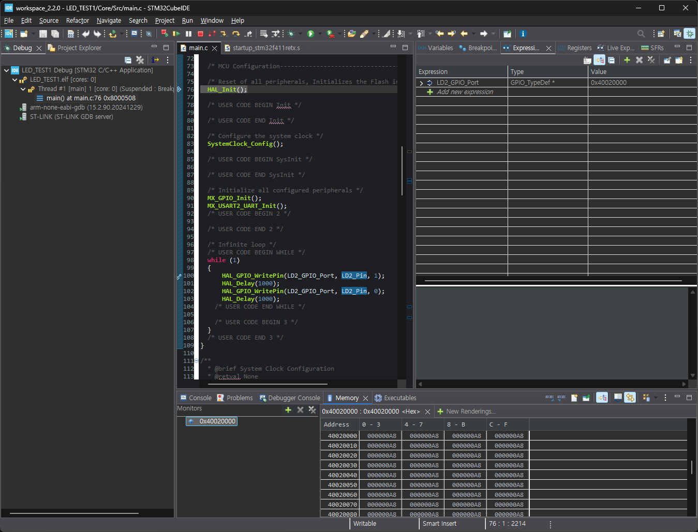 <br>

#### 5.	HAL_Init(); 실행
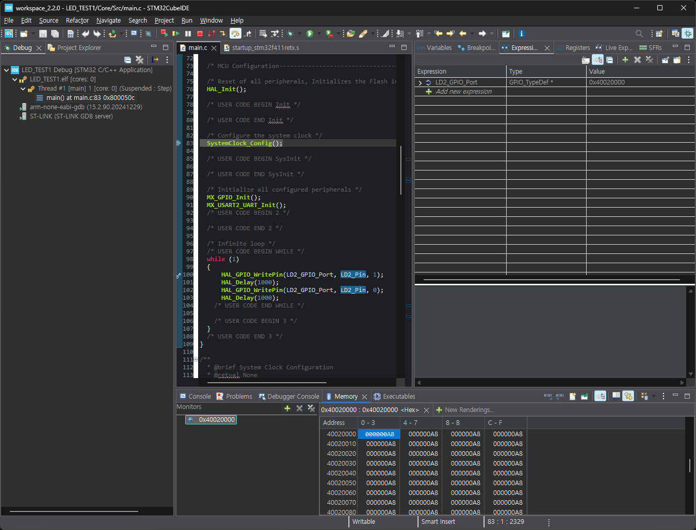 <br>

#### 6.	SystemClock_Config(); 실행
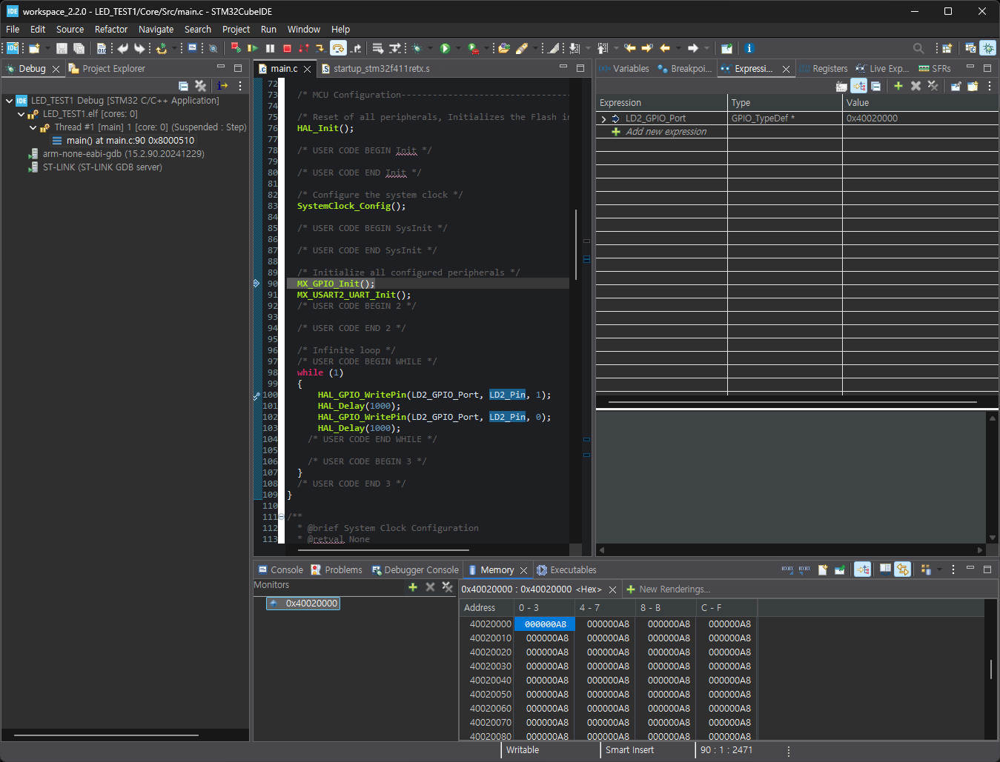 <br>

#### 7.	MX_GPIO_Init(); 실행
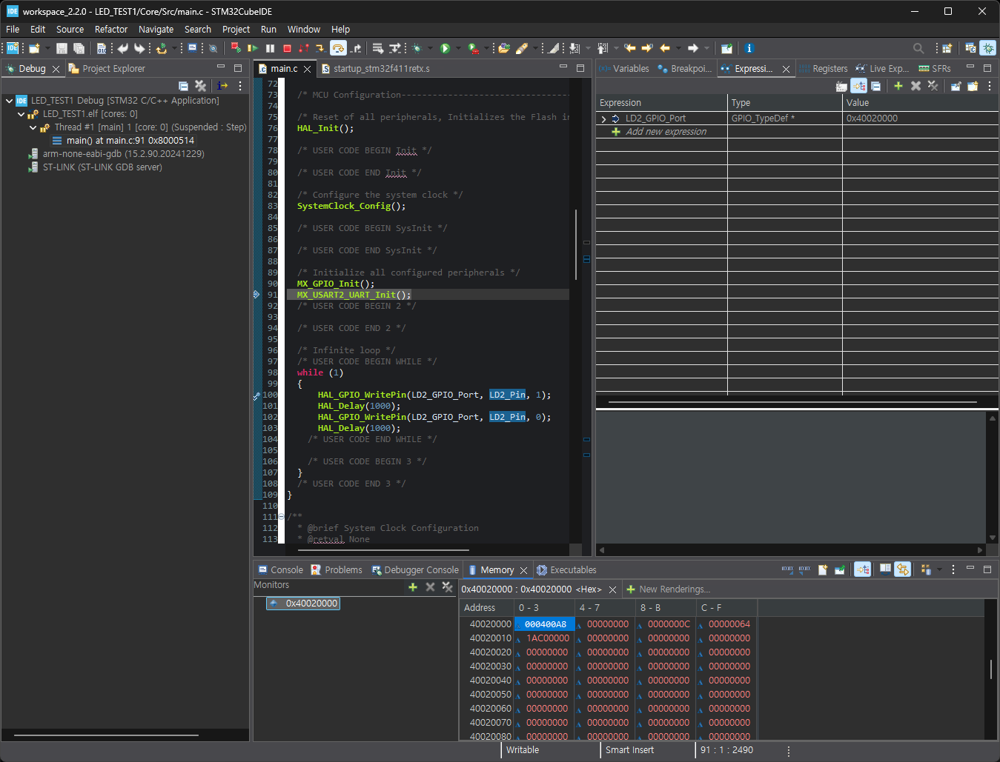 <br>

#### 8.	MX_USART2_UART_Init(); 실행
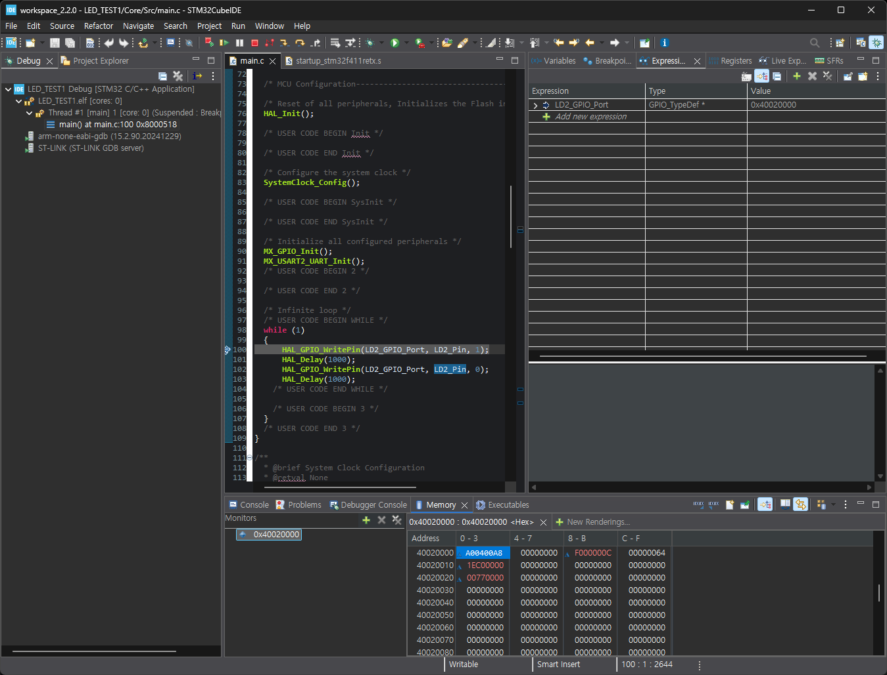 <br>

#### 9.	HAL_GPIO_WritePin(LD2_GPIO_Port, LD2_Pin, 1); 실행
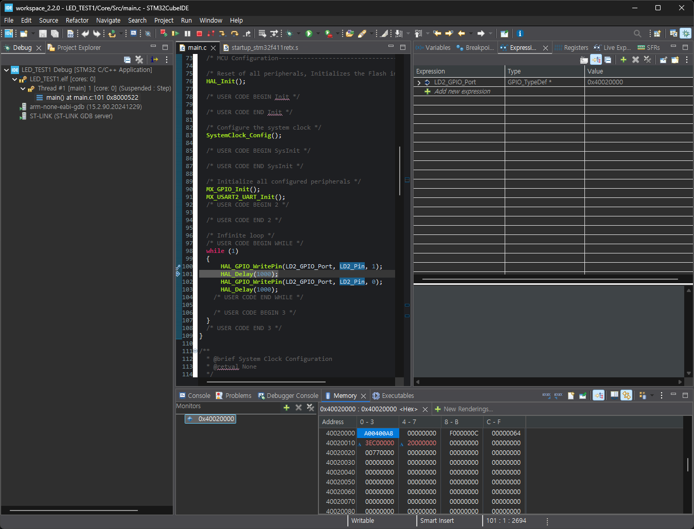 <br>

#### 10. HAL_Delay(1000); 실행
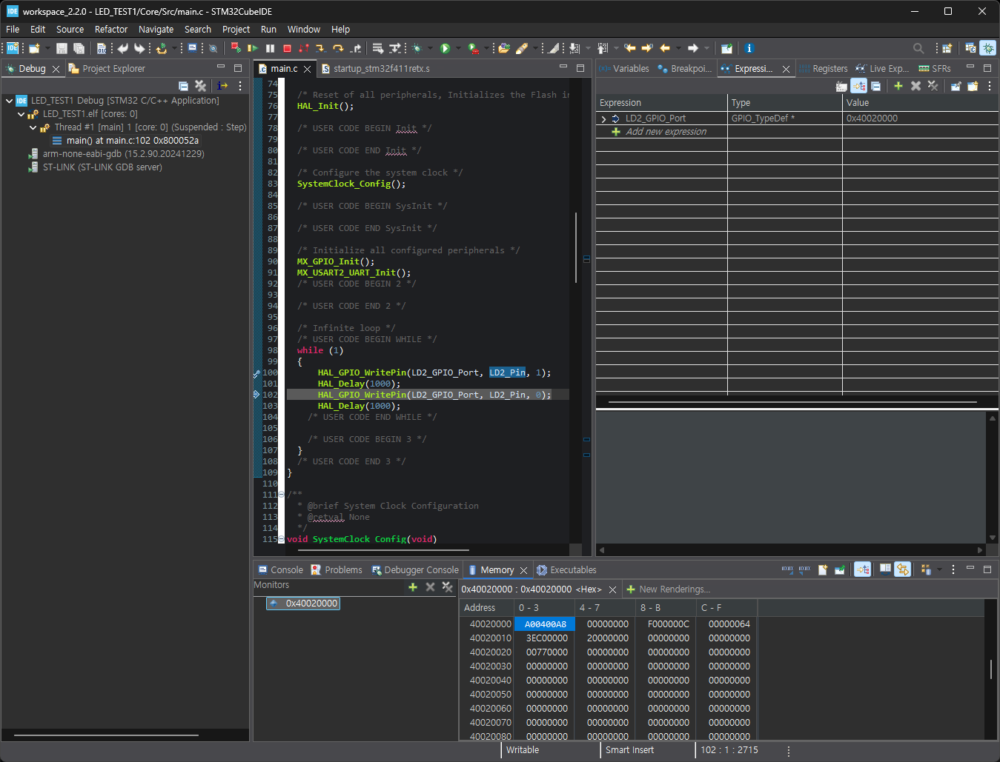 <br>

#### 11. HAL_GPIO_WritePin(LD2_GPIO_Port, LD2_Pin, 0); <br>
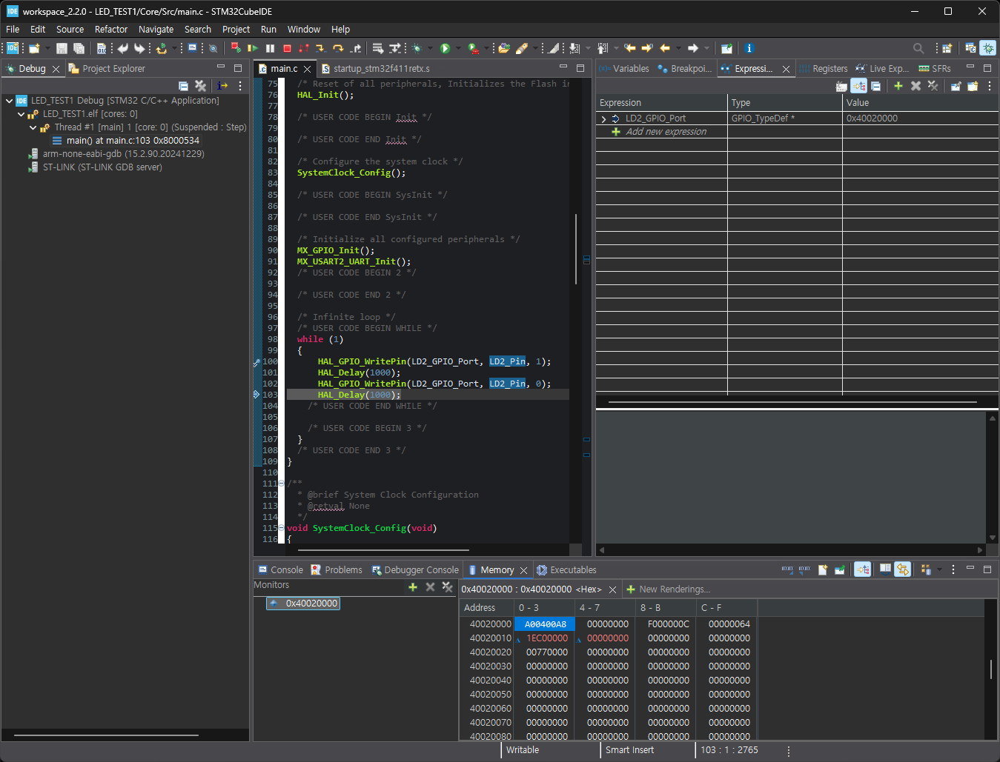 <br>

#### 12. HAL_Delay(1000); 실행
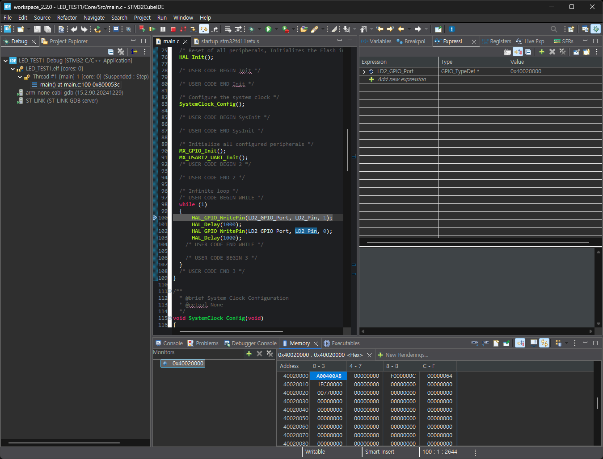 <br>
