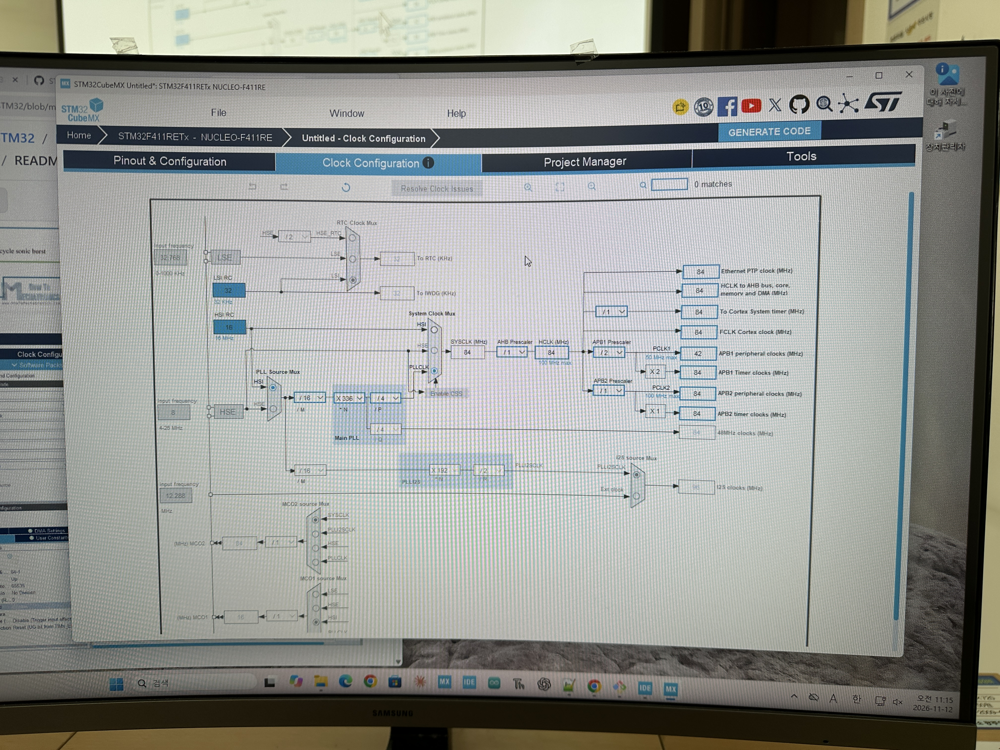

# HC-SR04 초음파 거리 센서
---
## 1. 하드웨어 구성(CUBEMX)

| 핀 | 포트 | 기능 | AF |
|----|------|------|----|
| **ECHO1** | **PA1** | GPIO_Input | AF2 (TIM3) |
| **TRIGER1** | **PA0** | GPIO Output Push-Pull | — |

### HC-SR04 연결

```
STM32F411                    HC-SR04
  PA0  ───────────────────── TRIG
  PA1  ───────────────────── ECHO
  VCC  ───────────────────── VCC (3.3V)
  GND  ───────────────────── GND
```

> ⚠ PB0는 5V 내성이 있으므로 HC-SR04의 5V ECHO 출력을 직접 연결 가능.

## 2. 시스템 클럭 구성(CUBEMX)

```
HSI 16MHz → PLL x16 → SYSCLK 84MHz
  ├── AHB (HCLK) = 84MHz (Div1)
      ├── APB1 = 42MHz (Div2) → TIM1 clk = 84MHz (×2, prescaler>1 doubling 규칙)
      └── APB2 = 84MHz (Div1)
  
```

![Clock configuration]<br>"Clock configuration"

### TIM1 설정 (CubeMX)

| 파라미터 | 값 | 비고 |
|----------|----|------|
| Prescaler | `64-1` | 64MHz ÷ 64 = 1MHz |
| Counter Mode | UP | — |
| Period (ARR) | `65535` | max 65.535ms (1 tick = 1µs) |
| AutoReloadPreload | Disable | — |
| ClockDivision | No Division | — |
| CH3 | Input Capture direct TI3, RISING | 에코 시작 |
| CH4 | Input Capture indirect TI3, FALLING | 에코 끝 |
| Update IT | `__HAL_TIM_ENABLE_IT(&htim3, TIM_IT_UPDATE)` (CODE) | 오버플로우 타임아웃 감지, `USER CODE`에 수동 추가 |


> ⚠ **NVIC 활성화도 별도 필요**: CubeMX **NVIC Settings** 탭에서 `TIM3_IRQn=true`로 설정해야 Update IT가 실제로 CPU에 전달됨.
> `Update IT`는 **어떤 이벤트**를 인터럽트로 받을지 선택하는 TIM 내부 마스크이고,
> `NVIC TIM3_IRQn`은 **인터럽트 자체를 CPU로 라우팅**하는 게이트 역할.
> CubeMX에서는 NVIC Settings 탭에서만 설정 가능하며, `USER CODE`에서는 불가능.

[⬅️ 메인 README.md로 돌아가기](../README.md)

